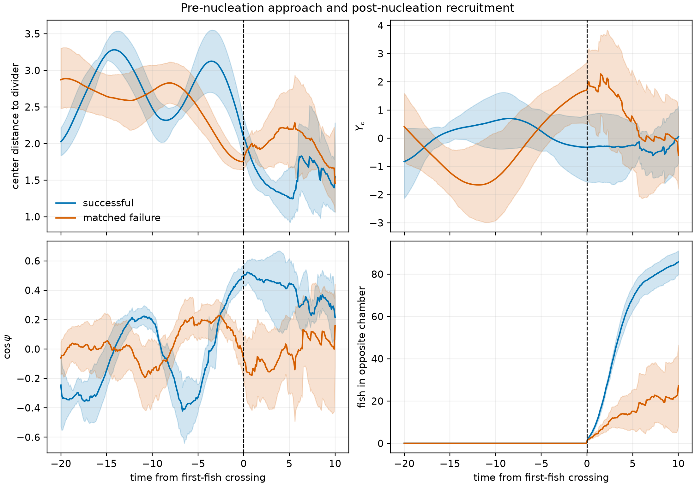
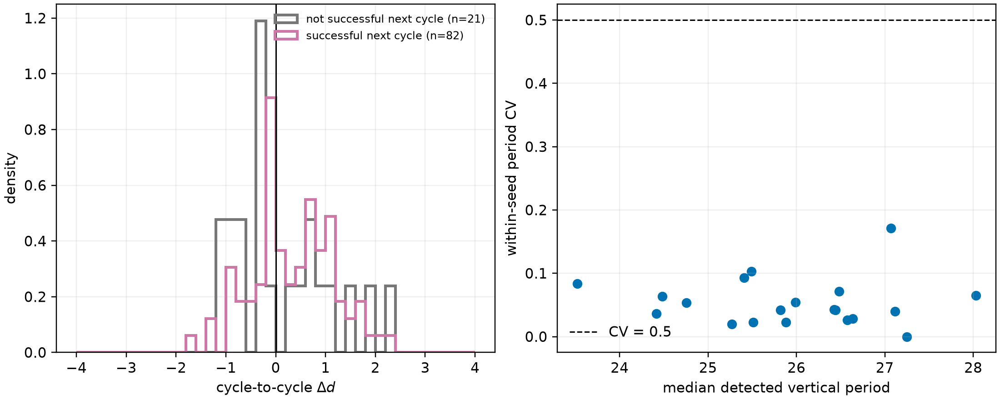
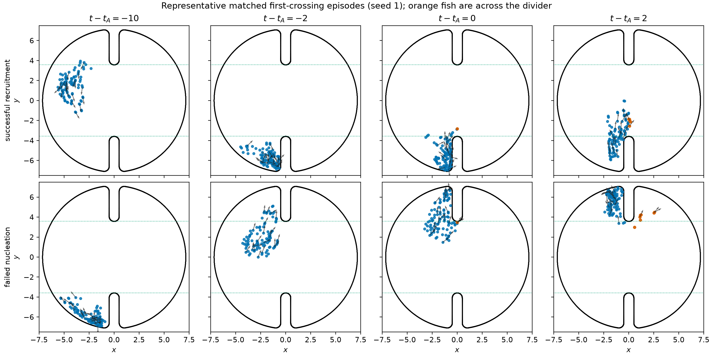
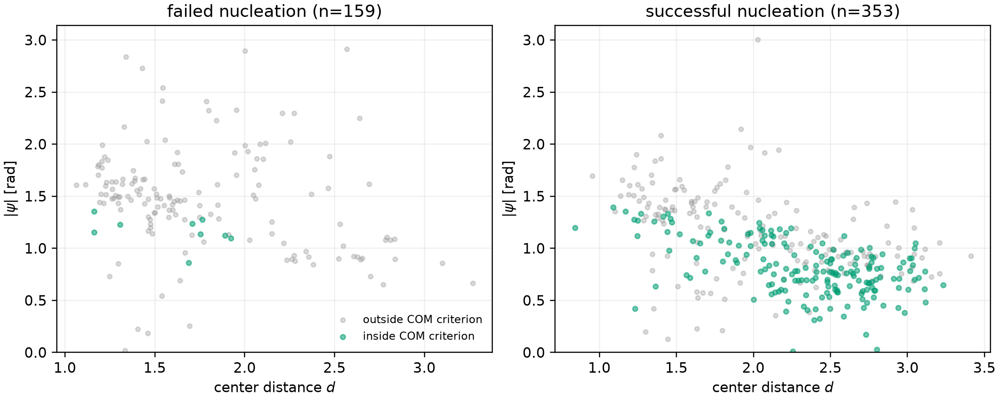
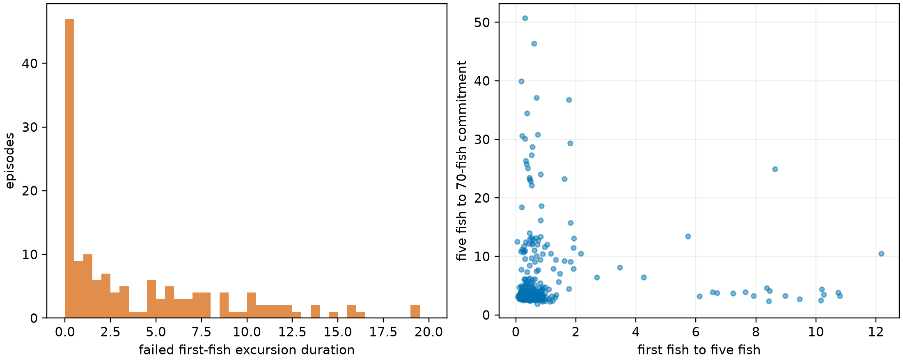
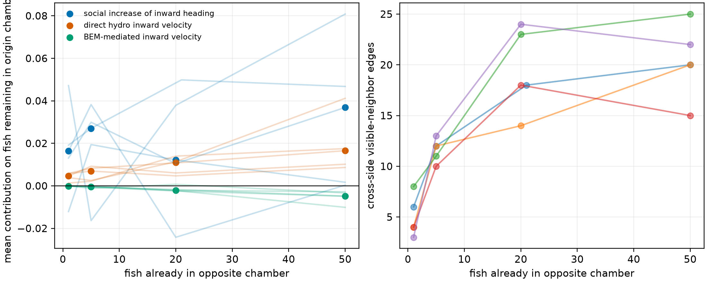

# Physical precursor to hydrodynamic bichamber switching

## Decision

The best-supported stopping classification is **B: crossing nucleation followed
by opposite-chamber recruitment**.

The school does execute a highly repeatable vertical oscillation, but successful
switches are not preceded by a progressive cycle-to-cycle motion of its center
toward the divider. The informative event is instead a geometrically accessible,
inward-oriented and spatially extended configuration. A leading fish then crosses;
successful events recruit the rest of the school within a few time units. Fish in
the opposite chamber cannot cause the pre-nucleation approach because that chamber
is exactly empty by construction. Once fish have crossed, cross-side social and
hydrodynamic terms can amplify recruitment.

This conclusion concerns the 20 existing full-BEM `R50/gap50` trajectories after
discarding 200 time units. No new BEM trajectory and no effective potential were
constructed.

## What the microscopic model actually permits

The state update implemented in `BEM_bichamber_parallel_instance.py` is

\[
\dot{\mathbf r}_i=\mathbf e(\theta_i)+\mathbf U_i^{\rm direct}
 +\mathbf U_i^{\rm BEM},
\]

\[
d\theta_i=\left(\omega_i^{\rm direct}+\omega_i^{\rm BEM}
 +\omega_i^{\rm wall}+\omega_i^{\rm vision}\right)dt
 +I_n\,dW_i.
\]

The direct dipolar velocity and turning are summed over every other fish
(`GetHydro`, lines 966--1005). The BEM response is obtained by solving the boundary
integral system for the combined dipole forcing and evaluating the induced velocity
and velocity gradient at each fish (`GetHydroBEM`, lines 1008--1059). These two
channels are therefore global and include fish across the divider.

Social neighbors are Delaunay/Voronoi neighbors (lines 852--859), but an edge is
removed if the connecting segment crosses a solid divider segment or either rounded
tip (lines 895--916). Thus fish cannot attract or align *through solid wall*, but
fish on opposite sides can interact socially when their line of sight passes through
the opening. For retained neighbors,

\[
\omega_i^{\rm vision}=
\frac{\sum_j [I_p\sin(\theta_j-\theta_i)+\rho_{ij}\sin\alpha_{ij}]
(1+\cos\alpha_{ij})}
{\sum_j(1+\cos\alpha_{ij})},
\]

where the first term aligns headings and the second attracts toward a neighbor
(lines 931--963). Wall avoidance predicts the forward wall intersection and applies
approximately

\[
\omega_i^{\rm wall}=I_w\,\mathrm{sign}(\phi_i)/d_i,
\]

with a steep near-wall correction (lines 1227--1246). Angular noise is
`In*sqrt(dt)*Normal(0,1)` (lines 1219--1224). The explicit attraction-to-a-point
term is commented out, and the assembled dynamics contain no target or force that
systematically pulls the school toward the divider (lines 1366--1372). Geometry can
still bias motion indirectly through wall turning and the BEM response.

## Event definition and controls

The aggregate series were sampled every 0.01 time units. Event A is the first frame
with any fish in the opposite chamber after a frame interval with all 100 fish in
one chamber. A nucleation is called successful if the opposite population reaches
70 before returning to zero; the 70-fish point is event B, collective commitment.
This gives 512 first-fish episodes: 388 in discovery seeds 0--14 and 124 in held-out
seeds 15--19. There are 353 successful and 159 failed nucleations.

The event-aligned comparison uses 33 one-to-one matched pairs for which the opposite
chamber was empty for the full preceding 20 units. Matching used only position and
heading information at -10, within the same seed and origin chamber when possible.
Values after a failed episode returns to zero are censored. Confidence intervals in
the main summaries resample independent seeds; no frame is treated as independent.

## The proposed slow inward approach is not present

Vertical motion is real and regular. All 20 seeds supplied usable same-phase pairs;
the detected period is approximately 24--28 and the median within-seed period CV is
0.042. Therefore a cycle comparison is meaningful rather than forced.

It does not show the proposed inward envelope. Across 103 complete same-phase cycle
pairs, mean \(\Delta d=d_{n+1}-d_n\) is +0.338 before a successful crossing and
+0.134 otherwise. Their seed-clustered difference is +0.360 with 95% interval
[-0.101, 0.816]. The sign is outward, and the interval does not establish a
difference.

The continuous pre-event history gives a stronger rejection. Over a complete
10-unit empty-opposite-chamber window, successful events have mean center-distance
slope +0.065 in discovery and +0.069 in held-out data, whereas failures have -0.129
and -0.093. Positive means moving away from the divider. Only 34% of discovery and
30% of held-out successes have negative slope, compared with 77% and 75% of failures.
The seed-clustered success-minus-failure slope difference is +0.191 [0.143, 0.238].
Thus selecting a decreasing envelope backward from a successful event would give a
misleading mechanism.

## The useful precursor is geometric orientation plus extent

The center straight-flight condition

\[
|Y_c+d\tan\psi|<g/2,\qquad \cos\psi>0
\]

is satisfied at first crossing in 51% of discovery successes versus 6.6% of
failures. The held-out fractions are 55.8% versus 2.6%. The seed-clustered difference
is 0.451 [0.371, 0.521], and the inward-heading component itself differs by 0.390
[0.303, 0.482]. The condition is therefore physically informative, although its
roughly 50% sensitivity means a center-only ray cannot describe every leading-edge
crossing.

Spatial extent resolves this apparent contradiction. At first crossing the leading
edge is essentially at the midline in both outcomes (median clearance about
0.003--0.006), but successful school centers are farther away: held-out medians 2.34
versus 1.61. Successful schools are also wider in the divider-normal direction; the
seed-clustered difference in horizontal standard deviation is +0.094
[0.052, 0.134]. The representative snapshots show a long leading edge entering the
opening while the center remains well inside the origin chamber.

The defensible precursor components are consequently (i) leading-edge clearance or
normal extent, (ii) inward polarization, and (iii) the projected vertical intercept
with the opening. Center distance alone is not the reaction coordinate.

## Nucleation is followed by rapid recruitment

In successful events the median time from the first fish to five fish is 0.50 in
discovery and 0.45 in held-out data. The subsequent median time from five fish to
70-fish commitment is 3.44 and 3.49. Failed excursions return in a median 2.60 and
2.69. Event-aligned curves therefore separate almost immediately after event A.

Opposite-side forces are exactly zero before event A, so they cannot initiate the
pre-crossing configuration. A diagnostic replay of one representative successful
episode in each held-out seed decomposed the source terms at 1, 5, 20 and 50 crossed
fish. The net direct-plus-BEM cross-side hydrodynamic contribution to inward velocity
of fish remaining in the origin chamber increases from 0.00421
[0.00263, 0.00547] at one fish to 0.0136 [0.00655, 0.0252] at 50 fish. This is smaller
than the same-side hydrodynamic contribution (0.139 at one fish), but consistently
inward. The direct contribution is positive; the boundary-mediated part is smaller
and usually opposing.

Cross-side visible-neighbor edges increase from mean 5 to 20 across those stages.
The social contribution to increasing inward heading is 0.0197
[0.0016, 0.0328] at five fish and 0.0333 [0.0082, 0.0584] at 50 fish, but its interval
includes zero at one and 20 fish. With only five held-out episodes this decomposition
is mechanistic evidence, not a population-wide causal estimate. It supports
amplification after nucleation, not an opposite-side cause of the initial approach.

## Interpretation and next experiment

The data support a limit-cycle-like vertical circulation. Noise and wall-induced
turning occasionally place an extended leading edge in the opening with a coherent
inward heading. That first crossing either dies out within a few units or recruits
the school rapidly. Cross-gap social coupling and a modest direct-hydrodynamic pull
help the recruitment stage.

A later reduced model should therefore start from a geometric commitment coordinate
built from leading-edge clearance, inward polarization and opening intercept—not a
potential in center distance and not another fit to occupancy alone. The cleanest
causal follow-up would hold a matched pre-event configuration fixed and selectively
remove cross-side social or hydrodynamic terms after the first fish crosses. That
requires new counterfactual simulations; it cannot be inferred more strongly from
the saved observational trajectories.

## Limits

- “Complete transition” is operationalized as 70-fish commitment before a return to
  zero, consistent with the prior dominance threshold; alternative thresholds
  should be a robustness check, not a parameter search.
- The center ray ignores finite school width and individual heading dispersion.
- Only 103 complete empty-chamber cycle pairs exist, so the cycle-to-cycle contrast
  is less precise than the frame-history and geometric results.
- Interaction replay uses five independently held-out episodes and reconstructs
  terms from archived states; it is not an intervention.
