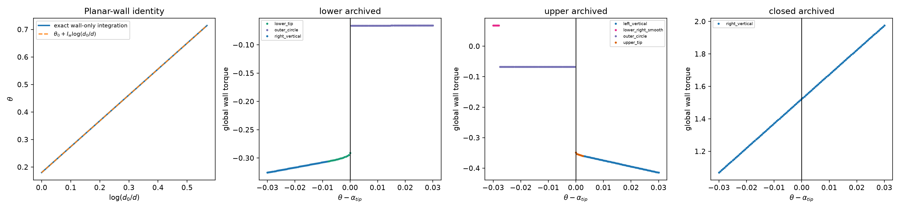
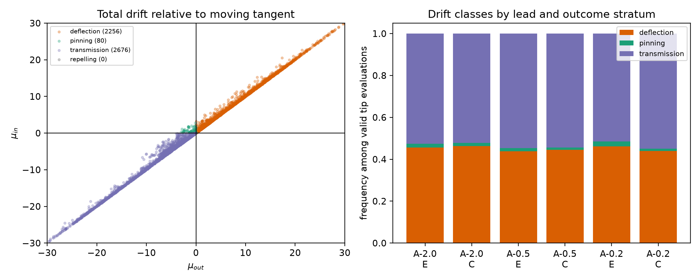
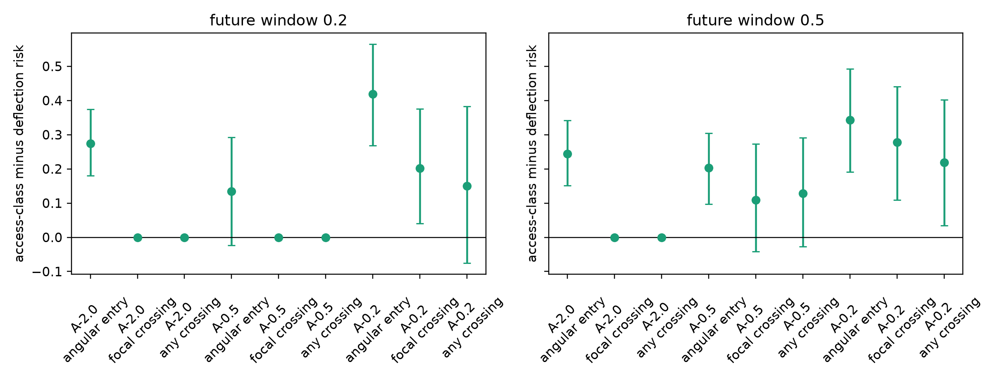
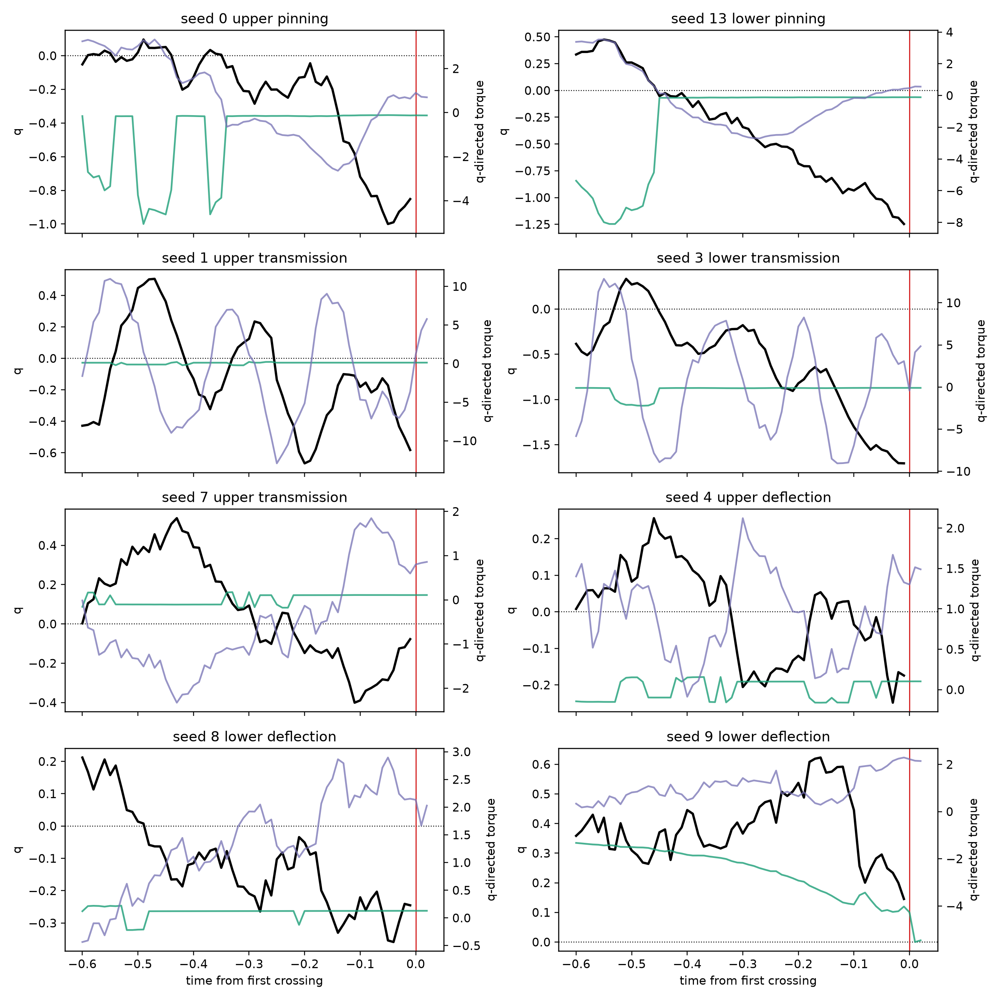
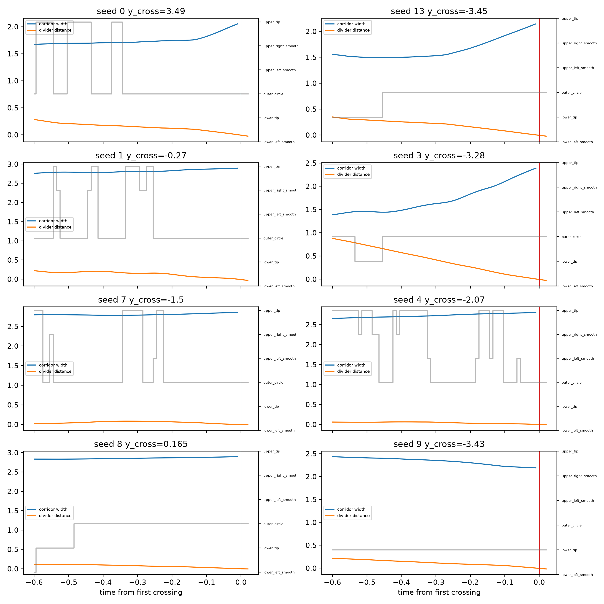

# Geometry-derived angular access at the rounded divider tips

## Question and answer

This analysis tested whether the exact forward-ray wall rule creates a robust
one-sided angular pin or transmission mechanism at the rounded bichamber tips.
It used the existing 20 gap/R = 0.5 full-BEM trajectories, with no new
simulation, fitted potential, logistic surrogate, or empirical physics
coefficient.

The result is **partial and bounded**:

1. **Geometrically exact: yes, conditionally.** The planar-wall logarithmic
   identity and the rounded-tip ray-branch transitions follow from the actual
   simulator. A closed tangent interval occurs in archived configurations and
   must be declared invalid.
2. **Dynamically supported: the switch is a transmission kick, not a stable
   pin.** Just outside either tangent, the rounded-tip wall torque points into
   the corridor and is stronger than the far-wall torque just inside. In the
   full deterministic angular rate, however, stable pinning occurs in only
   1.60% of valid evaluations. Social and hydrodynamic dynamics usually make
   both one-sided rates have the same sign.
3. **Predictive of chamber crossing: not independently established.** The
   transmission/pinning label predicts future angular entry, but spatial
   crossing at A-0.5 is not significant after the available geometry matching.
   A positive association at A-0.2 is based on small, poorly overlapping
   matched samples and can represent an already committed trajectory. It is
   not evidence that the tangent switch initiates the transition.

Accordingly, the proposed mechanism is useful as an exact **instantaneous
angular boundary condition**, but not as a closed reaction coordinate or a
static angular barrier. No effective potential is justified by these results.

## Exact simulator audit

The production equations were read from the local archived source
`../BEM_bichamber_parallel_instance.py`:

- `GetInterc` (forward-ray selection): lines 686--846;
- `GetVision` (visual alignment plus attraction): lines 931--964;
- `GetHydro` and `GetHydroBEM`: lines 966--1090;
- `GetWallAvoid` and `Check_jumping`: lines 1227--1260;
- the update, clipping, and override sequence: lines 1329--1391.

The already audited, standalone replay is
`../pre_crossing_turning/scripts/replay_dynamics.py`. The new focal replay in
`scripts/exact_tip_dynamics.py` preserves:

- the minimum positive ray intersection over the outer circle, divider flats,
  two inner tip circles, and four outer smoothing circles;
- the exact visual-neighbor graph and heading-dependent visual weights;
- direct and boundary-mediated hydrodynamic angular terms;
- short-range wall amplification
  \(1+d_{ray}^{-(m-1)}\) for \(|d_{ray}|\leq0.1\), with \(m=6\);
- clipping at \(\pm\pi/\Delta t\);
- removal of both hydrodynamic angular terms under the simulator's segment
  crossing or velocity safeguard.

For a focal fish, the BEM boundary right-hand side is exactly affine in
\(\cos\theta\) and \(\sin\theta\). The implementation therefore solves the
existing LU system for three right-hand sides,

\[
 \sigma(\theta)=\sigma_{other}+\cos\theta\,\sigma_c+
                 \sin\theta\,\sigma_s,
\]

and evaluates any trial heading exactly. This is algebraic acceleration, not a
fit. At 20 tangent evaluations from five seeds, the maximum discrepancies from
full simulator-function evaluation were \(3.55\times10^{-15}\) for total
angular rate and \(4.16\times10^{-17}\) for BEM angular torque. The analytic
gate velocity differed from a one-step trajectory derivative by at most
\(6.07\times10^{-4}\).

## Geometry and one-sided dynamics

### Planar wall

For a flat vertical wall, perpendicular distance \(d\), forward-ray distance
\(s=d/\cos\theta\), unit self-propulsion, fixed selected wall, \(s>0.1\), and
no non-wall angular terms,

\[
 \dot d=-\cos\theta,\qquad
 \dot\theta=-I_w\frac{\cos\theta}{d},
 \qquad
 |\theta(d)|=|\theta_0|+I_w\log\frac{d_0}{d}.
\]

Wall-only integration using the exact ray routine followed this identity with
maximum angular error \(1.58\times10^{-6}\) until the selected branch changed.
The identity is therefore exact only on the stated branch and outside the
amplification/clipping region; it is not a global invariant of the bichamber.

### Rounded-tip corridor

In chamber-reflected coordinates, let \(d>0\) point from the fish toward the
divider and let the tip centers be
\(c_-=-g/2-r\) and \(c_+=g/2+r\). The collision-free tangent interval is

\[
 \alpha_- = \operatorname{atan2}(c_--y,d)
             +\arcsin\frac{r}{\sqrt{d^2+(c_--y)^2}},
\]
\[
 \alpha_+ = \operatorname{atan2}(c_+-y,d)
             -\arcsin\frac{r}{\sqrt{d^2+(c_+-y)^2}}.
\]

It exists only if the focal point is outside both tips, \(d>0\), and
\(\alpha_-<\alpha_+\). Among 2,736 prospective snapshots, 230 had a closed or
otherwise invalid interval; their 460 tip evaluations were not classified.
The archived closed example has width -0.0747 rad and is shown explicitly in
Figure 1.

At valid archived upper and lower configurations, headings at
\(\alpha_{tip}\pm10^{-3}\) select different ray branches. The transition is at
the analytic tangent to within the 5e-4-rad sweep resolution. Outside the upper
tangent the selected branch is the upper tip; outside the lower tangent it is
the lower tip. The signs mirror correctly: local upper-tip torque is negative
and local lower-tip torque is positive, both turning toward the corridor.

For the upper boundary define \(q_+=\theta-\alpha_+\); for the lower boundary
define \(q_-=\alpha_- -\theta\). Thus \(q>0\) is outside and \(q<0\) is inside
for either tip. Including the measured gate velocity,

\[
 \mu_{out}=\dot q(\theta_{tip}\pm\epsilon),\qquad
 \mu_{in}=\dot q(\theta_{tip}\mp\epsilon).
\]

The prescribed classes are deflection (\(\mu_{out}>0\)), pinning
(\(\mu_{out}<0<\mu_{in}\)), and transmission
(\(\mu_{out}<0,\mu_{in}<0\)). The unlisted fourth quadrant is reported as
repelling rather than silently reassigned.

The wall contribution to \(\dot q\) is negative on both sides. Its pooled
means were -0.455 outside and -0.124 inside for the upper tip, and -0.446 and
-0.123 for the lower tip. The mean wall jump (outside minus inside) was -0.331
and -0.322, respectively. The discontinuity therefore strengthens
**transmission into the corridor**; it does not by itself create a stable pin.

## Prospective archived-snapshot test

The prospective risk set contains 456 event/control pairs over 20 independent
seeds. Events and controls were previously matched by seed, origin chamber,
and vertical-oscillation phase. At A-2, A-0.5, and A-0.2, the focal fish was
chosen prospectively as the closest fish still in the origin chamber. Position
velocity came from the saved one-step displacement. Both tips were evaluated
at \(\epsilon=10^{-3}\) and \(5\times10^{-3}\) rad. Future angular entry and
focal/any-fish chamber crossing were then measured separately over 0.2 and 0.5.

At \(\epsilon=10^{-3}\), among 5,012 valid evaluations:

| class | count | frequency | seed-bootstrap 95% interval |
|---|---:|---:|---:|
| deflection | 2,256 | 0.450 | [0.432, 0.469] |
| pinning | 80 | 0.0160 | [0.0115, 0.0209] |
| transmission | 2,676 | 0.534 | [0.514, 0.554] |

The class agreed between the two epsilon values in 99.63% of cases. Pinning
was nearly symmetric between lower (1.80%) and upper (1.40%) tips and showed no
meaningful upward/downward phase dependence (1.42% versus 1.79%). It increased
near the divider (2.27%) relative to the far divider-distance tertile (0.54%),
but remained rare. Only one wall strength, \(I_w=0.94\), exists in these
hydrodynamic data, so an \(I_w\) dependence cannot be tested without new data.

### Prediction versus angular error and proximity

For fish initially outside the selected tangent, transmission plus pinning was
compared with deflection. Whole-seed bootstrap intervals were used; fish and
frames were not treated as independent replicates.

- At A-2, the access class predicted angular entry within 0.2 (seed-mean risk
  difference 0.274, 95% interval [0.180, 0.375]) and 0.5 (0.244,
  [0.151, 0.341]). No chamber crossings occur in those short windows.
- At A-0.5, matching access-class and deflection configurations within seed,
  origin, and tip on initial angular error and divider distance retained 61
  pairs. Angular entry within 0.5 remained higher by 0.153 [0.009, 0.311], but
  focal crossing was 0.151 [-0.018, 0.332] and any-fish crossing was 0.082
  [-0.137, 0.298]. The mean standardized matching distance was 1.15, indicating
  weak overlap; these are sensitivity estimates, not controlled causal effects.
- At A-0.2, the analogous 22-pair match gave positive crossing differences,
  but overlap was worse (mean standardized distance 1.38) and the trajectory is
  already very close to event A. A separate event/control rematch on angular
  error and divider distance retained 41 pairs: access-class enrichment was
  0.191 [0.020, 0.392], while pinning enrichment was exactly 0 in the retained
  seed strata. This late signal is attributable to transmission, not stable
  pinning, and cannot distinguish initiation from commitment.

Thus the one-sided drift contains genuine short-horizon information about
**angular corridor entry**, but independent prediction of spatial crossing is
not established at a useful pre-commitment lead.

## Fixed-fish traces

Eight fixed-fish event traces were selected prospectively at A-0.5: two each
with an instantaneous pinning label, three transmission, and three deflection.
All source terms were replayed every 0.01 time unit from A-0.6 to crossing.
The first spatial crossings occurred 0.004--0.009 before the event marker due
to the saved-grid/event-marker convention.

The traces verify that ray switching and wall torque act before crossing, but
also show why a static pinning mechanism fails. The two nominal pinning traces
retained that label for only 35% and 18% of pre-crossing samples and were more
often transmitting. Two transmission examples retained transmission for only
45% and 27%; one retained it for 92%. All three displayed deflection examples
still crossed, and their deflection label was persistent. Non-wall torque often
varied on the same timescale and was larger than the wall term. The selected
ray branch switched 0--16 times across the 0.6-unit pre-crossing records.

These traces are illustrations, not additional independent statistical
replicates; the seed-cluster conclusions above carry the inferential weight.

## Verdict and stopping decision

### (i) Geometrically exact

**Yes, within its stated domain.** The planar identity, tangent formulas,
moving-gate derivative, mirrored torque signs, and ray-branch switch are exact
consequences of the simulator. The cone must be rejected when
\(\alpha_-\geq\alpha_+\), and the planar identity stops at branch switching,
short-range amplification, clipping, or addition of non-wall terms.

### (ii) Dynamically supported

**Only as an instantaneous transmission boundary condition.** The rounded-tip
switch creates an inward angular kick, but stable pinning is rare and generally
not persistent. The actual angular dynamics remain strongly time-dependent
through social alignment/attraction, hydrodynamics, gate motion, and ray-branch
turnover. This rejects a static one-dimensional angular landscape for the full
pre-crossing process.

### (iii) Predictive of chamber crossing

**No at a defensible pre-commitment lead.** The class predicts angular entry.
Spatial-crossing differences at A-0.5 include zero; the positive A-0.2 result
has small, poorly overlapping matched samples and is too close to crossing to
identify the initiating cause. Deflection does not preclude crossing.

The negative stopping rule therefore applies. The hypothesis should not be
rescued by fitting a potential or empirical coefficient. If this exact geometry
is used in later theory, it should enter a nonautonomous angular first-passage
model with a moving corridor and dynamic non-wall torque, not a static barrier;
the present data do not yet justify developing that reduced model as a
predictor of chamber crossing.

## Reproducibility map

- `configuration.json`: parameters, source branch, inputs, and sampling design.
- `scripts/exact_tip_dynamics.py`: exact branch-labeled wall rule and focal BEM replay.
- `scripts/analyze_tip_mechanism.py`: prospective extraction and outcomes.
- `scripts/validate_tip_replay.py`: comparison with full simulator functions.
- `scripts/make_representative_traces.py`: fixed-fish traces.
- `scripts/summarize_tip_mechanism.py`: seed bootstrap, matching, tables, figures.
- `tables/exact_replay_validation.csv`: numerical replay validation.
- `tables/geometry_verification.csv`: valid and closed-cone branch tests.
- `tables/class_frequencies.csv`: class frequencies and conditioning.
- `tables/prospective_association.csv`: unadjusted and geometry-matched outcomes.
- `tables/event_control_matched_summary.csv`: event/control sensitivity analysis.
- `tables/representative_trace_summary.csv`: trace persistence and branch turnover.

Large raw trajectories and LU factors remain outside Git and are referenced by
`configuration.json`.
