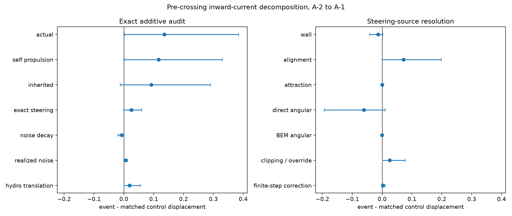
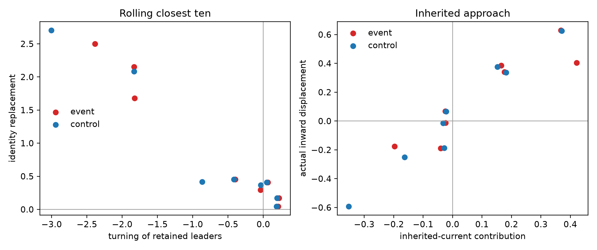

# Exact microscopic origin of pre-crossing inward current

## Result in one paragraph

For the archived geometry, **gap = R**, so **gap/R = 1** and
**gap/(2R) = 0.5**. In a bounded native-step replay of one phase- and
distance-matched event/control pair from each of eight independent seeds,
events moved inward by 0.136 more than controls over A-2 to A-1 (seed-bootstrap
95% interval [0.002, 0.385]). Self-propulsion supplied 0.116 [0.002, 0.329] of
this contrast and effective direct+BEM translation supplied 0.0195
[0.0004, 0.0556]. Crucially, 0.092 of the 0.116 self-propelled contrast (79%)
was current already present at A-2. Exact finite-step deterministic steering
added only 0.0255 [-0.0001, 0.0599]. Alignment had a positive full-interval
impulse, but neither its first-half impulse nor its displacement contribution
excluded zero. Thus the data support **inherited favorable orientation plus
self-propelled approach**, with possible alignment amplification, not a
resolved event-specific torque impulse that initiates the approach.

No potential, logistic surrogate, empirical coefficient, or new simulation was
used.

## Design and scope

The source risk set contains 456 event/control pairs across all 20 existing
full-BEM seeds. Exact native-step source replay is expensive, so the
prespecified bounded analysis used seeds 0--7 and selected one complete matched
pair per seed by minimum pre-existing distance-match cost, without using any
future outcome or torque quantity. Each event and control interval is exactly
A-2 to A-1; it ends one full time unit before first crossing. There are 16
segments (four left-origin and four right-origin seed pairs), 16,000 native
updates, and 16,000 BEM replays. Intervals, not fish or
frames, are compared, and uncertainty resamples the eight independent seeds.

This subset is sufficient for an exact mechanism audit but modest for inference.
The intervals are consequently reported rather than hidden. In particular,
one seed contributes much of the mean inherited-current contrast; deleting it
reduces that contrast from 0.092 to -0.005. The corresponding leave-one-seed-out
range for the actual displacement contrast is 0.013--0.156.

## Derivation and sign convention

For origin-chamber sign (s=+1) on the left and (s=-1) on the right,

\[
J_s={s\over N}\sum_i\cos\theta_i,
\qquad
S_k=-{s\over N}\sum_i\sin\theta_i\,\Omega_i^{(k)}.
\]

Itô's lemma applied to
(d\theta_i=\Omega_i,dt+I_n,dW_i) gives

\[
dJ_s=\left[\sum_k S_k-{I_n^2\over2}J_s\right]dt+dM.
\]

Define positive inward displacement as
(X_{in}=s[\bar x(T)-\bar x(0)]), and
(J_H=sN^{-1}\sum_i(U_{direct,x}+U_{BEM,x})_i). Then

\[
\Delta X_{in}=T J_s(0)
+\sum_k\int_0^T(T-t)S_k(t)dt
-{I_n^2\over2}\int_0^T(T-t)J_s(t)dt
+\int_0^T(T-t)dM_t
+\int_0^T J_H(t)dt.
\]

These plus signs for torque production, martingale increments, and inward
hydrodynamic current follow directly from the stated definition of (J_s).
The opposite signs in the task's displayed displacement formula are not
consistent with its preceding SDE and inward convention; forcing them fails the
identity. The implementation therefore uses the sign-consistent formula above.

## Exact finite-step audit

The production orientation update is Euler with Gaussian noise. Conditional on
the saved state,

\[
E[s\cos\theta_{i,n+1}\mid\mathcal F_n]
=s e^{-I_n^2\Delta t/2}
 \cos(\theta_{i,n}+\Omega_{i,eff}\Delta t).
\]

Every observed current increment is split exactly into

1. deterministic steering
   (D_n=sN^{-1}\sum_i[\cos(\theta_i+\Omega_i\Delta t)-\cos\theta_i]);
2. Gaussian decorrelation
   (Q_n=sN^{-1}\sum_i(e^{-I_n^2\Delta t/2}-1)
   \cos(\theta_i+\Omega_i\Delta t));
3. realized zero-conditional-mean residual
   (R_n=J_{n+1}-E[J_{n+1}\mid\mathcal F_n]).

Discrete summation by parts then reconstructs the self-propelled displacement
without approximation. The maximum per-step identity residual is
(5.4\times10^{-16}); the integrated reconstruction residual is
(1.7\times10^{-15}) or smaller. Replayed effective angular velocities agree
with velocities independently inferred from the saved increment and exact RNG
stream to RMS (2.3\times10^{-12}). The center translation identity is also at
roundoff (residual below (8\times10^{-16})).

Wall, alignment, attraction, direct-hydrodynamic, and BEM angular terms use the
actual production visibility, short-range wall amplification, clipping, and
collision/speed overrides. At clipped points, no physical source is assigned an
arbitrary share: the difference between the clipped effective angular velocity
and the sum of effective named terms is reported as `clipping_override`.
Hydrodynamic angular and translational terms are zeroed when the production
override requires self-propulsion-only motion. Total effective translational
hydrodynamics is additionally inferred directly from the saved position update,
so warning/collision corrections are included exactly.

## Displacement decomposition

Values below are event minus matched control over A-2 to A-1. Intervals are
whole-seed bootstrap 95% intervals.

| contribution | difference | 95% interval |
|---|---:|---:|
| actual inward displacement | 0.1359 | [0.0020, 0.3846] |
| self-propelled displacement | 0.1164 | [0.0016, 0.3291] |
| inherited current (T J_s(0)) | 0.0921 | [-0.0126, 0.2900] |
| exact deterministic steering | 0.0255 | [-0.0001, 0.0599] |
| angular-noise decorrelation | -0.00681 | [-0.0197, -0.0001] |
| realized stochastic residual | 0.00566 | [0.00075, 0.0124] |
| effective translational hydrodynamics | 0.0195 | [0.00038, 0.0556] |

The positive realized noise term is not a torque and not a deterministic
mechanism. Its conditional mean is exactly zero. It is positive here because
the sample is retrospectively stratified by whether a future event occurs.

The continuous torque-source contribution to displacement is:

| angular source | difference | 95% interval |
|---|---:|---:|
| wall avoidance | -0.0135 | [-0.0422, 0.0018] |
| social alignment | 0.0714 | [-0.00036, 0.1980] |
| social attraction | 0.00054 | [-0.00058, 0.00218] |
| direct hydrodynamic torque | -0.0608 | [-0.1940, 0.0098] |
| BEM-mediated torque | -0.00024 | [-0.00225, 0.00157] |
| aggregate clipping/override | 0.0255 | [0.000002, 0.0765] |
| exact finite-step correction | 0.00253 | [-0.00200, 0.00972] |

The named source sum plus aggregate clipping and the finite-step correction is
the exact steering term. Alignment and direct hydrodynamics are large and
opposing in some seeds; neither weighted contribution is independently
established with eight seeds. The aggregate clipping term cannot be given a
microscopic source label without an arbitrary allocation.

For the unweighted change in current, the full-interval alignment impulse is
0.144 [0.000006, 0.393], while its A-2 to A-1.5 impulse is 0.0723
[-0.00048, 0.201]. Wall torque over the full interval is negative, -0.0350
[-0.102, -0.00033]. This timing matters: alignment can amplify current during
the approach, but the data do not show a seed-robust positive alignment impulse
in the early half that precedes the approach. Most additional displacement was
already encoded in (J_s(A-2)).

## Renewing leading edge

At every native step, the closest ten origin-side fish were reselected. The
change in their current was split algebraically into (i) heading change of fish
retained in both sets and (ii) entrants minus leavers. This identity has a
residual below roundoff.

| rolling-ten quantity | event mean | control mean | paired difference [95% interval] |
|---|---:|---:|---:|
| current change | 0.215 | 0.115 | 0.100 [0.002, 0.217] |
| turning of retained members | -0.748 | -0.715 | -0.032 [-0.349, 0.239] |
| identity replacement | 0.963 | 0.831 | 0.132 [-0.069, 0.474] |
| unique identities during 1 time unit | 17.25 | 16.25 | 1.0 [-0.125, 2.375] |

The positive rolling-edge current is the small difference of large negative
turning and positive replacement contributions. Neither component has an
established event-specific contrast. Therefore an apparent acceleration of a
rolling closest-ten statistic must not be interpreted as angular acceleration
of fixed fish; renewal of membership is essential in both events and controls.

## Physical verdict and stopping decision

1. **Exact consequence of the microscopic equations:** favorable collective
   heading produces inward self-propelled translation; the finite-step current
   and displacement identities are verified at roundoff. Noise causes the
   specified Itô decorrelation, and its realized residual is not a torque.
2. **Directly supported by these trajectories:** event intervals have more
   inward motion, and self-propulsion is the dominant channel. The mean excess
   is mostly inherited at A-2. Alignment is a plausible later amplifier, while
   wall and direct-hydrodynamic torque oppose it on average in this subset.
3. **Not established:** a distinct positive microscopic torque impulse that
   initiates reorientation before approach. The early alignment interval and
   the total steering displacement include zero, and the inherited-current
   estimate is dominated by one seed.
4. **Leading edge:** rolling-edge current is not the current of a material set;
   replacement and turning largely cancel. No event-specific split is resolved.

The safest mechanism statement is therefore: **crossing events preferentially
occur when the school has already acquired a favorable inward current; that
current then produces approach through self-propulsion. Social alignment may
maintain or amplify it during approach, but this bounded test does not identify
the initiating turn.** The same torque channels and strong leading-edge renewal
occur in matched controls, so they are generic dynamics rather than a unique
trigger. This negative stopping criterion is met: no potential or feature
search is warranted from these results.

## Reproducibility

- `scripts/analyze_inward_current.py`: exact RNG, replay, finite-step audit,
  torque-source decomposition, seed bootstrap, and rolling-ten identity.
- `analysis_config.json`: seeds, native step, interval, inputs, and geometry.
- `tables/segment_decomposition.csv`: one row per event/control segment.
- `tables/paired_event_control_summary.csv`: seed-level means and intervals.
- `tables/seed_paired_differences.csv`: transparent independent-seed contrasts.
- `tables/sampled_source_histories.csv`: native-step replayed sources.

Large raw trajectories, geometry matrices, and LU factors remain external and
are referenced by the script invocation; no raw trajectory is committed.
