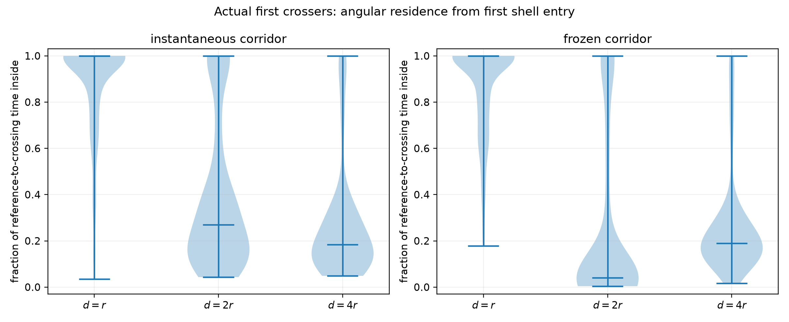
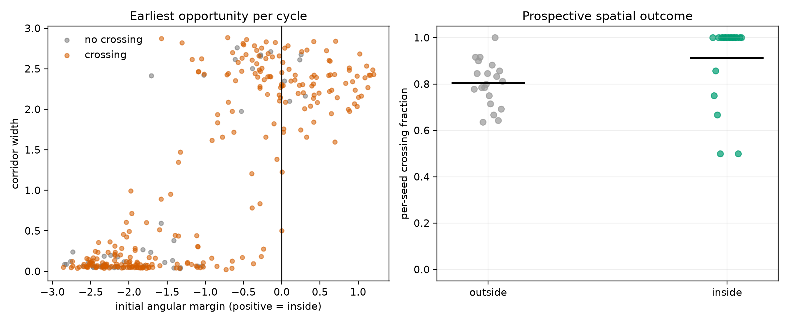

# Phase-conditioned angular gate: validation against full-BEM crossings

## Verdict

**Decision B: the frozen-corridor approximation is inadequate as the dominant crossing mechanism.**

The geometric angular gate is physically meaningful and prospectively informative, but the full-BEM first crosser usually does not retain an admissible heading from the prespecified primary shell \(d=2r\) to the divider. At \(d=2r\), only 11.0% [7.7%, 14.6%] of analyzable first crossers remained inside the frozen corridor, and 14.0% [11.2%, 17.0%] remained inside the moving corridor. The moving-corridor residence fraction was 38.2% [35.2%, 41.1%]. Near \(d=r\), persistence rose to 54.3% [49.1%, 59.4%] for the frozen corridor and 58.0% [53.0%, 62.8%] for the moving corridor. Thus persistence is a useful **terminal passage condition for a substantial fraction**, not a closed preparation-and-flight mechanism from \(2r\).

Prospectively, angular margin at the first \(d=2r\) shell opportunity had a seed-level AUC of 0.657 [0.579, 0.737]. Being inside rather than outside the corridor increased the per-seed probability of first-fish crossing before the next phase return by 0.111 [0.013, 0.199]. This establishes information before the outcome, but not frozen-corridor closure: many candidates renew, leave and re-enter the gate, and a favorable earliest candidate was the eventual first crosser in only 20.6% [14.7%, 26.8%] of crossing cycles.

No coefficient, potential, logistic model, or new simulation was used.

## Geometry and sample

The archived case is 'R50/gap50': **gap = R**, hence **gap/R = 1** and **gap/(2R) = 0.5**. In the nondimensional saved coordinates, \(g=R=7.1589105316\) and rounded-tip radius \(r=0.5\). The data are the existing 20 independent full-BEM seeds, with \(N=100\), \(I_w=0.94\), \(I_n=0.5\), \(I_p=4\), and \(I_f=0.01\). Only this one \((I_w,I_n)\) point is available, so this analysis cannot identify an optimal-noise ridge.

The exact collision-free tangent corridor at normal distance \(d>0\) and height \(y\) is

\[
\alpha_-=\operatorname{atan2}(-g/2-r-y,d)+
\arcsin\frac{r}{\sqrt{d^2+(-g/2-r-y)^2}},
\]
\[
\alpha_+=\operatorname{atan2}(g/2+r-y,d)-
\arcsin\frac{r}{\sqrt{d^2+(g/2+r-y)^2}}.
\]

It is valid only when \(\alpha_-<\alpha_+\). Left and right chambers were reflected so that positive normal motion is always inward.

## A. Actual first-crosser persistence

There were 512 accepted first-fish nucleations. The reference is the first inward passage through each shell after the beginning of the full-occupancy episode; trajectories already inside that shell were retained as left-censored status records, not silently discarded. The corridor was evaluated at the native saved step \(\Delta t=0.001\), and the divider-crossing state itself was excluded because \(d\leq0\) makes the pre-crossing cone undefined. Intervals resample seeds, not frames or fish.

| reference | analyzable / 512 | left-censored | frozen persistent | moving persistent | frozen residence | moving residence |
|---|---:|---:|---:|---:|---:|---:|
| \(d=r\) | 434 | 15.2% | 0.543 [0.491, 0.594] | 0.580 [0.530, 0.628] | 0.867 [0.852, 0.884] | 0.875 [0.858, 0.893] |
| **\(d=2r\)** | **394** | **23.0%** | **0.110 [0.077, 0.146]** | **0.140 [0.112, 0.170]** | **0.239 [0.204, 0.275]** | **0.382 [0.352, 0.411]** |
| \(d=4r\) | 288 | 43.8% | 0.010 [0.000, 0.023] | 0.031 [0.014, 0.051] | 0.264 [0.240, 0.288] | 0.267 [0.238, 0.298] |

At the primary shell, the heading exited the frozen interval 77.9 times [70.9, 84.7] and the moving interval 32.4 times [29.5, 35.7] on average. Native-step boundary chatter contributes to these counts, but not to the persistent/nonpersistent classification or residence fraction. The result is therefore not a marginal failure caused by a few long excursions: 86% of analyzable crossers violate even moving-corridor persistence.

The mean reference-to-crossing time at \(2r\) was 12.17 [10.90, 13.51], whereas the isolated-swimmer conservative frozen-cone flight bound was 6.34 [6.21, 6.48]. The observed fish can take longer because it repeatedly leaves and re-enters, follows a curved path, and receives non-self translation. These quantities must not be compared as if the isolated sufficient bound were a full-BEM prediction.

The exact saved-step kinematic split from \(2r\) assigns 0.671 [0.607, 0.734] of the unit normal displacement to self-propulsion and 0.329 [0.266, 0.393] to the effective non-self residual. The latter equals direct-plus-BEM translation on ordinary updates and also contains production collision/override corrections when active; separating those terms over all long first-crosser paths would require the expensive microscopic replay deliberately excluded here. The result still establishes that favorable heading is not spatial passage by itself: roughly one third of the primary-shell displacement is non-self translation.

## B. Prospective phase-section test

The risk set was constructed before knowing the outcome: all fish occupied one chamber, the school center crossed \(Y_c=0\) upward, and another same-origin section was accepted only after \(Y_c\leq-r\). Each cycle ended at its next accepted return or its first fish crossing. At each of \(d=r,2r,4r\), every fish could renew into the leading edge; the cycle-level predictor was the earliest valid shell opportunity, with no use of future identity.

There were 316 cycles with valid \(2r\) and \(4r\) opportunities and 287 with a valid \(r\) opportunity. Results below are means of independent-seed quantities with seed-bootstrap 95% intervals.

| reference | cycles | crossing fraction | margin AUC | crossing rate: inside - outside | earliest candidate = first crosser, given crossing |
|---|---:|---:|---:|---:|---:|
| \(d=r\) | 287 | 0.916 [0.886, 0.946] | 0.714 [0.617, 0.809] | 0.037 [-0.050, 0.139] | 0.620 [0.546, 0.690] |
| **\(d=2r\)** | **316** | **0.831 [0.797, 0.864]** | **0.657 [0.579, 0.737]** | **0.111 [0.013, 0.199]** | **0.206 [0.147, 0.268]** |
| \(d=4r\) | 316 | 0.831 [0.797, 0.864] | 0.655 [0.567, 0.739] | 0.150 [0.078, 0.209] | 0.156 [0.110, 0.203] |

At \(2r\), only 22.4% [17.7%, 27.2%] of earliest candidates were initially inside the corridor, and the earliest candidate itself crossed in 17.8% [12.6%, 23.2%] of cycles. There were on average 55.0 candidate fish with a shell opportunity. The angular margin and corridor width therefore carry prospective information about a cycle, but the actual nucleating identity is usually selected later from a renewing population.

The \(d=r\) inside/outside rate contrast has a confidence interval crossing zero because the conditioned cycle set has a 91.6% crossing ceiling. Its stronger margin AUC and much larger first-crosser identity fraction instead show that the near-divider gate is temporally close to terminal selection.

## Relation to the finite-window theory

The imported analytical result is valid for prescribed constant preparation/flight drift and a stationary cone. Its five numerical consistency tests pass: tangent symmetry/closed-cone handling, probability bounds and limits, drift-reflection symmetry, the zero-drift eigenseries limit, and quadrature convergence.

What is exact:

- the full microscopic hybrid process and its full-state renewal identity;
- the rounded-tip tangent geometry;
- the finite-window eigenfunction solution **within its stated constant-drift, frozen-cone model**;
- the saved-step displacement split into self and effective non-self motion.

What is a reduced-model assumption:

- a frozen cone and constant angular drift over the flight;
- pure unit-speed translation in the geometric sufficient-condition proof;
- one persistent candidate rather than a renewing, correlated leading edge;
- identifying first-fish nucleation with collective recruitment.

The trajectory test rejects the first and third assumptions as a dominant description at \(2r\). It does not invalidate the mathematics of the reduced model; it limits that model to a conservative terminal-gate component.

## Physical interpretation and stopping decision

The most economical explanation supported by these data is:

1. the oscillating school repeatedly supplies many fish to a moving spatial-angular opportunity region;
2. angular margin and local corridor width bias which cycles are favorable;
3. candidate identity renews and headings repeatedly leave/re-enter the corridor;
4. near \(d=r\), persistent admissibility becomes a terminal filter for about 58% of analyzable first crossers;
5. self-propulsion provides most inward travel, while effective non-self translation remains material;
6. post-nucleation recruitment is a separate process.

The optional zero-noise BEM evolution was not run. The existing saved-trajectory test already meets the stopping rule by rejecting the dominant frozen-cone premise; a new deterministic BEM calculation would not rescue that premise and would add computational cost.

### Direct answers

1. **Does preparation plus persistence explain a meaningful portion?** Yes, as a near-gap terminal mechanism: about 54--58% persist from \(d=r\). No, as the dominant \(d=2r\)-to-crossing mechanism: only 11--14% persist.
2. **What determines passage rather than deflection?** Proximity, instantaneous rounded-tip geometry, angular margin, repeated angular re-entry, non-self translation, and renewal among many leading candidates. A favorable heading alone is insufficient.
3. **What is exact versus assumed?** Tangent geometry, the full-state generator/renewal structure, and saved-step kinematics are exact at their stated level. Frozen geometry, constant drift, pure unit-speed flight, candidate independence, and the mapping from nucleation to school switching are assumptions.
4. **Should we pursue an analytical \(I_w\)-\(I_n\) ridge now?** **No—not with the finite-window frozen-corridor model.** The one available parameter point cannot validate a ridge, and its central persistence assumption fails at \(2r\). A future first-principles reduction would need a moving spatial-angular process in \((d,y,\theta,\phi)\), phase-dependent microscopic drift/translation, and leading-edge renewal; recruitment must remain separate.

Detailed definitions and the exact reproduction command are in [METHOD.md](METHOD.md). Compact independent-seed values are in [seed_level_summary.csv](tables/seed_level_summary.csv).
