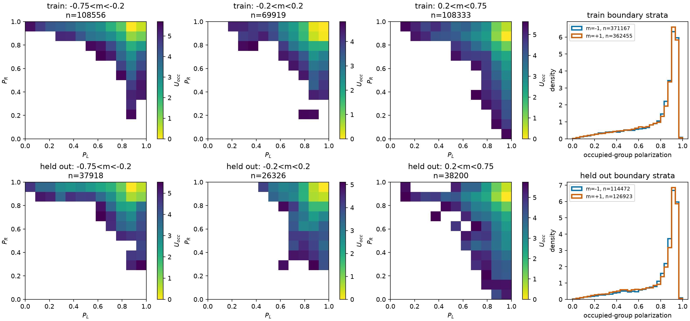
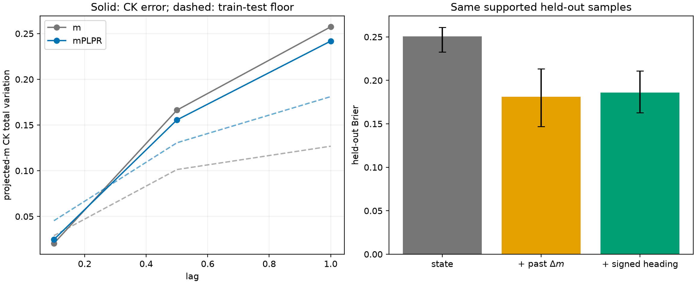
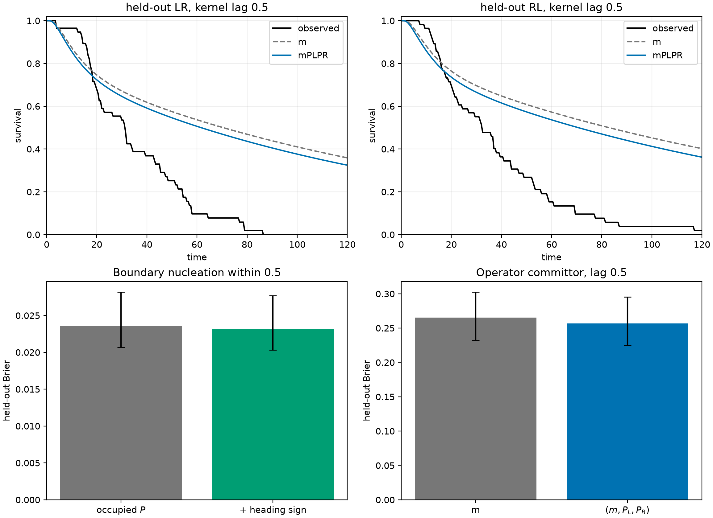

# Validation of the population--local-polarization state

## Decision

**B. The state (z=(m,P_L,P_R)) is a reproducible descriptive landscape, but it is not dynamically sufficient for collective switching.**

Separate chamber polarizations add a small, seed-reproducible amount of held-out splitting information beyond population imbalance. They do not remove direction/history dependence, do not pass the declared Markov check at any tested lag, and do not predict the held-out first-passage time scale. The missing physics is signed, persistent transport toward one chamber or the other. This is exactly the information retained by the earlier occupancy-plus-neck-current model and erased by polarization magnitudes.

No potential, neural model, logistic surrogate, new simulation, or adjustable physical coefficient was used.

## Data and state

All 20 existing full-BEM `R50/gap50` trajectories were available. The archive has **gap/R = 1** and **gap/(2R) = 0.5**. Seeds 0--14 are training and seeds 15--19 are held out; time 0--200 is discarded. The synchronized table contains 1,600,020 observations at (Delta t=0.01) and is 34,042,404 bytes compressed.

The simulator stores heading, not velocity angle, in `state[2]`. With the exhaustive convention `left: x<0`, `right: x>=0`, no separate gap population exists and (N_L+N_R=100) exactly. Thus

[
m=(N_R-N_L)/100,qquad
P_c=\left|N_c^{-1}\sum_{i\in c}(\cos\theta_i,\sin\theta_i)\right|.
]

When a chamber is empty its polarization remains `NaN`. The (m=-1) and (m=+1) boundary strata use only the occupied group's polarization; they were not removed or filled with zero. The extraction audit found a maximum difference of (1.1\times10^{-16}) between independently cached occupancy series and zero error in the counting identity.

## The occupancy landscape is real but is not an energy

The train and held-out stationary distributions agree visually and quantitatively. Across three mixed-occupancy slices, train--test Jensen--Shannon divergence ranges from 0.0074 to 0.0306 when the (P_L,P_R) grid is varied from (8^2) to (16^2) bins. The occupied-group polarization distributions on the two one-chamber boundary strata also nearly overlap under chamber exchange.

The plotted quantity (U_{occ}=-\log\rho_{ss}) is shown only in supported bins (at least 100 training or 30 held-out samples). Its valleys identify frequently occupied configurations. They are **not** a free energy, quasipotential, or kinetic barrier.

## Markov closure fails

The finite state model has 38 states: three occupied-polarization quantiles on each one-chamber boundary, and four (P_L/P_R) combinations inside each of eight imbalance intervals. All 38 states are supported. Transition operators were estimated at lags 0.1, 0.5 and 1.0.

In the switching corridor, the decisive Chapman--Kolmogorov results are:

| lag | model | projected-(m) CK error | train--test floor | full-state CK error | full-state floor |
|---:|---|---:|---:|---:|---:|
| 0.1 | (m) | 0.0205 | 0.0290 | 0.0205 | 0.0290 |
| 0.1 | (m,P_L,P_R) | 0.0248 | 0.0453 | 0.0894 | 0.0723 |
| 0.5 | (m) | 0.1663 | 0.1013 | 0.1663 | 0.1013 |
| 0.5 | (m,P_L,P_R) | 0.1556 | 0.1306 | 0.1797 | 0.2012 |
| 1.0 | (m) | 0.2574 | 0.1268 | 0.2574 | 0.1268 |
| 1.0 | (m,P_L,P_R) | 0.2418 | 0.1810 | 0.2764 | 0.2800 |

At lag 0.1 the full (z)-state error exceeds its sampling/heterogeneity floor. At lags 0.5 and 1.0 the projected-(m) error remains respectively 19% and 34% above its floor. Therefore no tested lag passes both parts of the same practical closure criterion used in the earlier ((q_\ell,J)) study.

## Future direction remains hidden at fixed state

Completed switching-corridor excursions supply 2,747 held-out future-direction samples; two final excursions are censored and receive no outcome. At operator lag 0.5, adding (P_L,P_R) changes held-out committor Brier score from 0.2653 to 0.2567. The paired seed difference is only -0.00852 [-0.0132, -0.00385]. Thus local coherence has genuine but small incremental value.

On exactly the same 2,478 held-out samples with supported conditional cells:

| predictor | Brier score | 95% seed interval |
|---|---:|---:|
| (m,P_L,P_R) state | 0.2506 | [0.2330, 0.2612] |
| state + strictly past (Delta m) | **0.1812** | [0.1469, 0.2134] |
| state + signed chamber heading | **0.1858** | [0.1621, 0.2108] |

Past (Delta m) improves Brier score by 0.0694 [0.0476, 0.0913], and signed heading improves it by 0.0648 [0.0496, 0.0811]. Within each of eight well-supported (z) cells, positive versus negative past transfer changes the training right-commitment probability by 0.38--0.93; the signed-heading split changes it by 0.31--0.71. These predictors are known at the prediction time. Their large held-out gains directly reject autonomous closure in the three magnitudes.

## Nucleation and recruitment are different

Nucleation was tested only on the (m=\pm1) strata, where the empty-group polarization is unavailable. The outcome is first departure from full occupancy within the next 0.5 time unit, sampled every 0.1 and evaluated by held-out seed.

The held-out exit fraction is 2.40% overall. It is 3.95% when the occupied group's mean heading points toward the gap and 0.57% when it points away. Adding only that heading sign to occupied-group polarization improves log loss from 0.1125 to 0.1036, a paired difference of -0.00891 [-0.0104, -0.00731]. The absolute Brier change is small because nucleation is rare. This confirms that coherence magnitude does not encode the angular access direction.

After nucleation, the strong past-increment and heading effects above concern recruitment/commitment. A single stationary landscape should not conflate these two stages.

## Held-out first-passage prediction is poor

At lag 0.5, the (z)-kernel predicts restricted mean switching times of 81.44 (left-to-right) and 86.78 (right-to-left), compared with observed 34.94 and 38.09. Its maximum survival errors are 0.420 and 0.411. The imbalance-only model is slightly worse (86.82 and 93.16), but the local polarizations do not repair the long artificial tail. Lag 1.0 remains too slow: 64.62 and 68.25.

For comparison, the previously validated ((q_\ell,J)) kernel at lag 0.5 predicted 38.72 and 38.26 against observed 36.27 and 38.22, with survival errors 0.172 and 0.123. That benchmark uses smooth occupancy (q_\ell), so the episode counts are not numerically identical; nevertheless the scale separation is unambiguous. Directional current, not coherence magnitude, is what removes the spurious long residence.

## Physical conclusion

The evidence supports this interpretation:

1. (m,P_L,P_R) cleanly describe how many fish occupy each chamber and whether each subpopulation is coherent.
2. They do not identify where either coherent subpopulation is pointing.
3. Two configurations in the same (z) cell can consequently have opposite persistent population currents and opposite commitment probabilities.
4. The state is useful for visualization and perhaps for conditioning a richer kinetic theory, but its stationary histogram cannot predict the transition rate.
5. The existing ((q_\ell,J)) result remains the better coarse-time predictive model. Its residual micro-lag memory still prevents interpreting it as an exact diffusion or energy landscape.

The requested decision is therefore **B**, not C: local polarization adds a small statistically resolved amount beyond imbalance, but not enough for dynamic sufficiency. The missing physical variable is signed directional transport/history. The investigation stops here rather than adding arbitrary coordinates or fitting a double well.

Only one ((I_w,I_n)) parameter point is present. These data cannot support an unfitted prediction of the wall-strength--noise optimal ridge.

Reproduction details and source paths are in [METHOD.md](METHOD.md); numerical values are in `tables/`.
