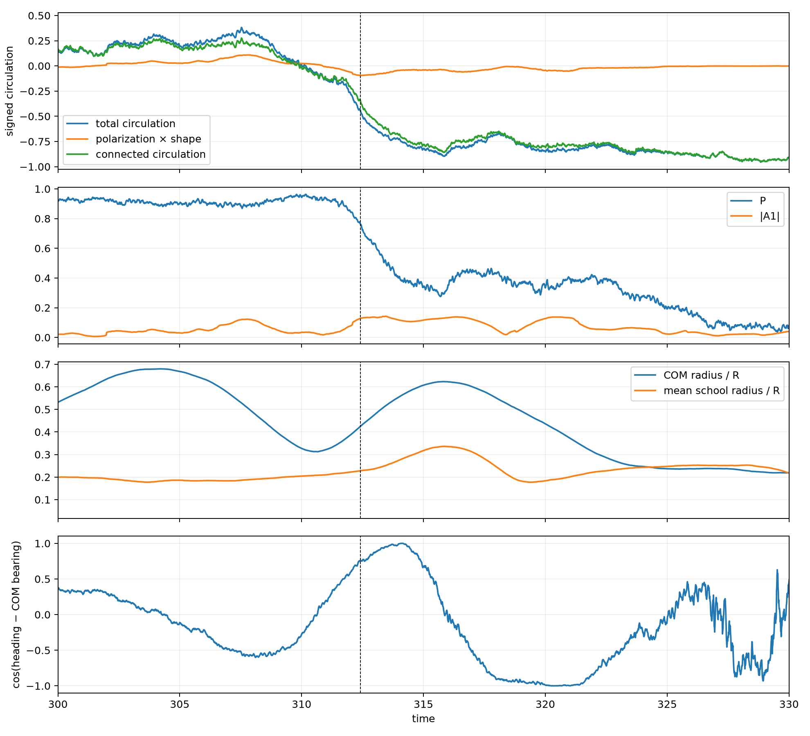
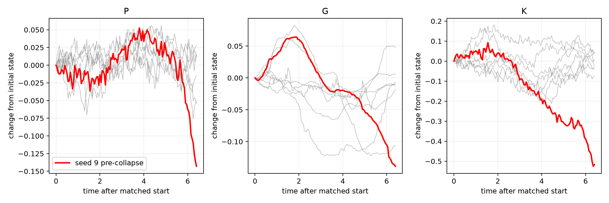
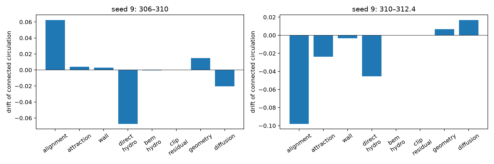
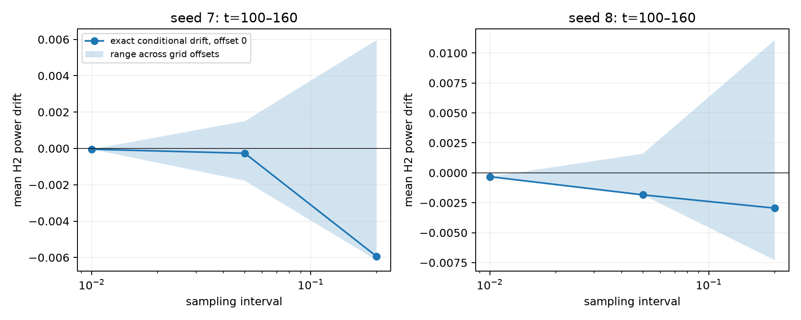

# Connected circulation before the schooling–milling transition

## Physical verdict

**Connected circulation, not the polarization–shape product, supplies most of the early circulation reversal in the one observed transition.** This is a resolved temporal precursor in seed 9, not evidence yet of a reproducible unstable eigenmode or its initiating cause. It reverses sign before growing in the eventual milling direction; its absolute magnitude does not grow monotonically from the start.

- From `t=306` to `310`, connected circulation changes by **−0.1901**, whereas the product contribution changes by **−0.0196**. Connected circulation accounts for **90.7%** of the signed circulation change, while polarization actually **increases by 0.0336**, from 0.910 to 0.944.
- Using equal decreases of 0.05 from the `t=306` baseline, persistent for 0.2 time units, connected circulation changes at **308.87**, the product at **310.96**, and polarization at **311.90**. The ordering persists for thresholds 0.025 and 0.1; these are descriptive thresholds, not fitted change points.
- By `t=312.4`, the connected change is **−0.5169**, compared with **−0.1388** for the product. Polarization first remains below 0.8 at **312.25**. Opposite connected circulation below −0.1 is already present at **310.85**.
- Seven independently seeded, initial-state-matched stable-schooling references have mean connected change **−0.0101**, with seed-bootstrap 95% interval **[−0.0394, 0.0193]**. None resembles the large event reversal. However, small reversals below −0.05 occur in **9 of 399** nonoverlapping stable-schooling reference windows; none reaches −0.1. Small connected changes are therefore not unique transition warnings.

These intervals quantify **control-seed variability only**. There is one transition seed, so neither transition-population uncertainty nor a causal mechanism is established. Controls are conditioned on remaining schooling throughout their comparison window, and are not a prospective classifier cohort. No stability boundary, fitted potential, or closed one-variable stochastic model is inferred.



The dashed line is the previous analysis's transition reference `t=312.41`, not a newly inferred onset. The [full seed-9 record](outputs/seed9_full_record.png) provides the longer-time context.



## Data, reference states, and numerical scope

All ten original `If1e-02_Ip40_In05_R50_num100_wid100_n{0..9}_BEM.mat` files are memory-mapped, unchanged. Parameters are `N=100`, `R=7.158910531638177`, `In=0.5`, `dt=0.001`. Geometry is sampled every 0.05 over `t=20–999.9`, and every 0.01 for seed 9 over `t=250–360`. The circulation identity has maximum absolute error **5.89×10⁻¹⁵**. No fish is exactly at the COM; the smallest sampled distance is **2.54×10⁻⁵ R**. Very close approaches can make continuous polar derivatives large, so exact finite-step conditional drift is retained rather than silently deleting these samples.

The fixed replay budget is 18,920 distinct snapshots: seeds 7 and 8 at interval 0.01 over `100–160`; seed 9 at interval 0.02 over `300–330` and `282–288.4`; seed 0 at interval 0.02 over `100–130`; and native-step two-unit blocks `100–102` in seeds 7 and 8. This replays archived states, not new trajectories. Source-specific stationary-school comparisons use the seed-0/seed-9 reference blocks; the seven-seed matched comparison uses geometry only, and is not misrepresented as matched source replay.

For the seven matched controls, candidate starts are separated by 10 time units and windows last 6.4. Matching uses initial polarization, signed circulation, COM radius, and mean school radius, with scales fixed from schooling data. Chirality is reflected using initial circulation, never eventual outcome. Reference windows require `P≥0.8` throughout; matching does not make the resulting retrospective contrast an unbiased prospective prediction test. The bootstrap resamples the seven whole seed-level changes, never individual fish or overlapping frames.

## Observable and interpretation

This analysis uses the existing circular-confinement trajectories and the original simulator's angular and translational equations. The measured connected circulation is

\[
K=\operatorname{Im}C,\qquad C=\langle e^{i\theta}e^{-i\phi}\rangle
 -\langle e^{i\theta}\rangle\langle e^{-i\phi}\rangle.
\]

Here \(\phi\) is measured about the instantaneous school COM. Write \(G=\operatorname{Im}(pA_1)\). Then \(M_C=G+K\) exactly. The product is **not** a complex-conjugate product. A uniformly aligned school has \(C=0\) regardless of its angular density; nonzero \(C\) measures correlations between individual heading deviations and position within the school.

Also, `|C| ≤ sqrt((1−P²)(1−|A1|²))`. Thus connected circulation and polarization are mathematically constrained, not independent order parameters. The early signed reversal while polarization increases is nevertheless not merely an algebraic consequence of polarization loss. Changes in COM position and relative school geometry are shown explicitly in the first figure; a fixed tank-center circulation would be a different quantity.

## Exact source drift

Let \(e_i=e^{i\theta_i}\), \(f_i=e^{-i\phi_i}\), \(A=\langle f\rangle\), and let \(\omega_i\) be the COM-relative orbital angular velocity computed from the effective stored translational update. For every physical angular source \(k\),

\[
D_{C,k}=i\langle e_i(f_i-A)\Omega_{i,k}\rangle,
\quad D_{C,\mathrm{geometry}}=-i\langle(e_i-p)f_i\omega_i\rangle,
\quad D_{C,\mathrm{diffusion}}=-\tfrac12 I_n^2 C.
\]

The requested real drift is the imaginary part of their sum. Alignment, attraction, wall, direct hydrodynamics, BEM hydrodynamics, and the effective angular-clipping residual are kept separate. The geometric term includes the moving COM; it is not the rotation about the fixed tank center. There is no extra Itô product correction between heading and position because position has finite variation in this model.

The source update draws angular noise before storing the next position, but the draw has zero position components and enters no positional decision. Thus the post-update \(\phi_i'\) is conditionally deterministic. With \(\theta_i^*=\theta_i+\Omega_{i,\mathrm{eff}}\Delta t\),

\[
E[C'\mid\mathcal F_n]=e^{-I_n^2\Delta t/2}
 \langle e^{i\theta_i^*}(e^{-i\phi_i'}-A_1')\rangle.
\]

This supplies an exact finite-step reference for the continuous drift. The analogous exact conditional second moment of \(H_2\) is reused for the stationary audit. Recorded \(\mathrm{rdot}[:,:,n+1]\) advances \(\mathrm{state}[:,:,n]\).

The independent centered finite-difference check of the complex drift has maximum error `2.98e-10`. Four fixed snapshots with 30,000 independent angular-noise redraws validate the conditional variance of `Im(C)` and of `|H2|²`; this is a noise redraw, not a new full-BEM trajectory. Finite-step checks use the nonlinear phasor update, not an assumption that clipped turns are small. For example, at seed 8 `t=112.4`, the continuous total angular contribution to connected drift is `+0.311`, whereas its exact finite-step contribution is `−0.677`: first-order source projections cannot be interpreted literally at that clipped step.

Across all 18,920 replayed snapshots, maximum velocity error is `5.33e-15`, position-update error `4.44e-16`, and visual-torque split error `9.29e-11`. The exact conditional-increment-plus-realized-noise identity closes to `5.43e-20` for connected circulation and `1.36e-20` for H2 power. Eight snapshots contain angular clipping, affecting 15 fish-snapshots; none occurs in the two pre-collapse budget windows. No collision or position-safety override is triggered in this replay set. These counts describe sampled states, not an exhaustive trajectory-wide safety audit.

## Which terms supply the connected reversal?

The table gives **sampled mean instantaneous drift**, not a trajectory-integrated attribution. Negative values promote seed 9's eventual negative circulation. These two adjacent event windows are not independent replicates.

| Source of `d Im(C)/dt` | `306–310` | `310–312.4` |
|---|---:|---:|
| Alignment | +0.06229 | −0.09800 |
| Attraction | +0.00411 | −0.02375 |
| Wall | +0.00287 | −0.00340 |
| Direct hydrodynamics | −0.06728 | −0.04546 |
| BEM hydrodynamics | −0.00041 | −0.00016 |
| Clipping residual | 0 | 0 |
| Moving-COM geometry | +0.01492 | +0.00677 |
| Angular diffusion | −0.02046 | +0.01677 |
| Continuous total | −0.00395 | −0.14723 |
| Exact finite-step conditional total | −0.01378 | −0.14873 |

Before `310`, direct hydrodynamics and diffusion reduce the initial positive connected circulation, opposed by alignment and COM geometric transport. After `310`, alignment and attraction reinforce the negative circulation; direct hydrodynamics continues to contribute negatively, while diffusion now opposes its magnitude. Diffusion always acts toward zero: its sign reversal is not a new physical torque. Wall turning is modest in these early windows; BEM angular turning is small. The geometric drift is positive on average in both windows, so the observed negative connected reversal is not explained by COM-basis transport alone.

The early competition is **not event-specific**. In the earlier seed-9 schooling block `282–288.4`, alignment contributes `+0.0494`, direct hydrodynamics `−0.0573`, geometry `+0.0164`, and diffusion `−0.0215`, comparable to the pre-reversal block. Seed 0 also shows this opposition: after reflecting its negative chirality for comparison, alignment is `+0.0465` and direct hydrodynamics `−0.0524`. These are sustained-schooling reference blocks, not independent matched transition replicates. A favorable hydrodynamic source alone therefore does not distinguish the initiating event.

**The initiating cause is unresolved.** Early continuous terms nearly cancel. Over `306–310`, the observed change divided by duration is −0.0475, whereas the sampled exact conditional drift is −0.0138. This discrepancy cannot be assigned entirely to noise: the interval is sampled every 0.02, not at every integration step, so temporal quadrature error and realized noise are both possible. There is no exact integrated torque attribution across that interval in this bounded replay. Later negative alignment supports the developing circulation but may be a response to the reorganization, not its trigger. No causal claim follows from a negative source or its timing alone.



## Dense stationary-balance audit: revise the previous H2 interpretation

Replaying exactly the same half-open mill windows `100≤t<160` with finer grids changes the mean **exact conditional H2 power drift** substantially:

| Sampling interval | Seed 7 | Seed 8 |
|---|---:|---:|
| 0.2 | −0.005943 | −0.002948 |
| 0.05 | −0.000265 | −0.001840 |
| 0.01 | **−0.000044** | **−0.000324** |

The continuous mean at interval 0.01 is `−0.000099` and `−0.000279`, respectively. Finite-step correction is especially important for seed 8 at the coarsest grid: its continuous mean is **+0.000756**, unlike the negative exact conditional mean. A grid that hits rare large turns can change both magnitude and sign. The intervals above are sampling intervals; the production integration timestep always remains 0.001.



This is direct evidence that **sparse sampling explains much of the earlier nonzero mean**. The shaded ranges span offsets of each coarser grid; they are quadrature-sensitivity ranges, not confidence intervals. The earlier report also pooled other time blocks, so the present table compares the same `100–160` block rather than claiming to reproduce all of its pooled means.

Native-step `100–102` blocks provide a different, exact check:

`endpoint power change / T = mean exact conditional power drift + realized martingale / T`.

The uncertainty scale for that martingale is `sqrt(sum conditional variances)/T`, not an independent-frame standard error. Even in a stationary process, a two-unit realization need not have zero time-averaged conditional drift. Conversely, a near-zero sampled average alone does not prove stationarity. Long-window occupation summaries and nonoverlapping ten-unit source blocks are retained for comparison; with two mill seeds, there is no precise ensemble stationarity claim.

| Native-step H2 balance, `100–102` | Seed 7 | Seed 8 |
|---|---:|---:|
| Mean exact conditional drift | +0.007355 | −0.006292 |
| Realized martingale / T | −0.006870 | +0.010144 |
| Conditional martingale standard-error scale | 0.004874 | 0.004583 |
| Actual endpoint change / T | +0.000485 | +0.003852 |

The realized residuals are −1.41 and +2.21 conditional standard-error scales. They are not both tiny, and a Gaussian significance claim is unwarranted from these two short blocks. The connected-circulation native balances likewise close: `+0.014240−0.003952=+0.010288` in seed 7 and `+0.013125−0.015433=−0.002308` in seed 8, with martingale scales 0.01456 and 0.01453.

There is also a finite-window qualification: seed 8's mean H2 power in `100–160` is **0.01254**, versus **0.00704** in `100–500` and **0.00692** in `500–900`. Thus the early block is not representative of the later occupation level; early relaxation or unusually strong finite-window fluctuations remain possible. Seed 7's corresponding means are 0.00703, 0.00586, and 0.00611. Sparse sampling is demonstrably important, but we do **not** assert that every remaining imbalance is sampling error or that strict stationarity has been established. The long-window endpoint rates are of order `10^-5`, not evidence of sustained power decay at the old coarse-grid rate.

**Do not infer an eigenvalue from mean negative drift power.** In stationary noisy motion, negative deterministic power can simply balance stochastic injection. Neither the old negative mean nor the current near-balance establishes a restoring derivative, a growing instability, or an energy landscape. The earlier “damped but noise-excited mode” wording is qualified in its report without deleting its historical results.

## What would constitute the next controlled test?

The present data establish a **candidate signed connected precursor in one event**, not a reproducible growing instability. Stop the observational search here. No extra fitted coordinate or parameter sweep is warranted, and no perturbation experiment is performed in this analysis.

If a causal follow-up is authorized, the smallest targeted test is a paired heading-only perturbation at a few archived pre-reversal states and their schooling controls, keeping positions and global polarization fixed to first order. At fixed positions,

\[
g_i=\frac{1}{N}\operatorname{Re}\{e^{i\theta_i}(e^{-i\phi_i}-A_1)\}
=\frac{\partial K}{\partial\theta_i}.
\]

Project `g` onto the nullspace of the two polarization-gradient rows `−sin(theta)/N` and `cos(theta)/N`, normalize the resulting direction `h` to unit RMS, and evaluate the unchanged simulator RHS at `theta ± epsilon*h`. A small `epsilon=10^-3` radians and its half-step check would test the sign of the local `b_K` response without an empirical coefficient or new long simulation. If the projected gradient vanishes, this constrained test is degenerate and should be reported, not replaced by a fitted direction. These are local conditional restoring/amplifying responses, **not** eigenvalues of a closed K dynamics; COM geometry and all other microscopic degrees of freedom remain dynamic in the real school. Additional independent spontaneous transitions would still be needed to establish reproducibility.

## Source and output map

- Production: `BEM_circular_parallel_instance.py` in the archive parent of the checkout; SHA256 `2a415d26ad83cf42a2f3cb0f4ba156b8dd6c11b32972ce8305499eebced22da4`.
- Read-only source replay: `theory/circle_collective_first_stage/com_relative_turning/analyze_com_relative_turning.py`, using `GetVision`, `GetWallAvoid`, `GetHydro`, `GetHydroBEM`, `Check_jumping`, angular clipping, and the later position-only safety retry.
- Raw inputs: `/Volumes/data/BEM_bichamber/archive_one_R_60/BEM_data/`, the ten files named above. No raw trajectory is committed.
- `outputs/seed9_changes.csv`, `equal_drop_onsets.csv`, `matched_controls.csv`, `control_uncertainty.csv`: chronology and seed-level reference comparisons.
- `outputs/connected_source_budget.csv`, `finite_geometry_audit.csv`, `replay.csv`: source-exact projections and finite-step references.
- `outputs/sampling_balance.csv`, `stationary_blocks.csv`, `stationary_occupation.csv`: dense and native-step stationarity audits; sampling offsets and time blocks are **not independent seeds**.
- `outputs/*audit.json`, `analysis_configuration.json`, `independent_identity_tests.csv`: numerical checks and reproducibility settings. Compact NPZ files contain only collective observables, not fish trajectories.

## Reproduction

Run from the repository root:

```bash
OPENBLAS_NUM_THREADS=1 VECLIB_MAXIMUM_THREADS=1 \
MPLCONFIGDIR=/tmp/mplconfig uv run --with numpy --with scipy --with matplotlib \
  python theory/circle_collective_first_stage/connected_circulation/analyze_connected_circulation.py \
  --data-dir /path/to/BEM_data
```

The driver streams the ten seeds, replays a fixed bounded snapshot set, and resumes from its compact `outputs/replay.csv` checkpoint. `--stage summary` regenerates summaries and plots without further BEM replay. No simulator, raw data, or earlier numerical table is changed.
