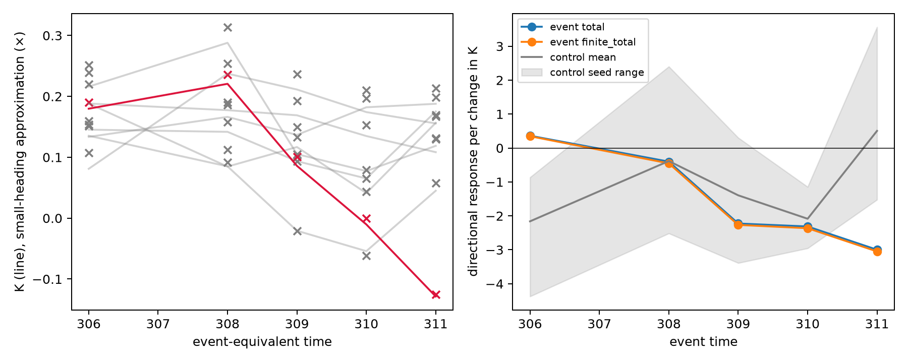
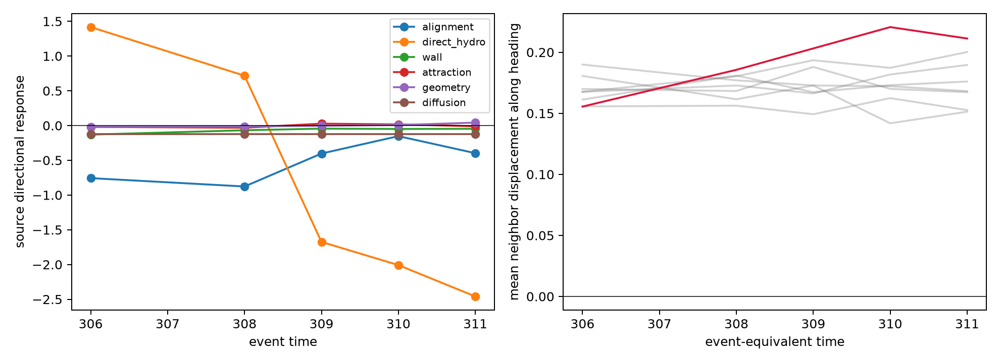
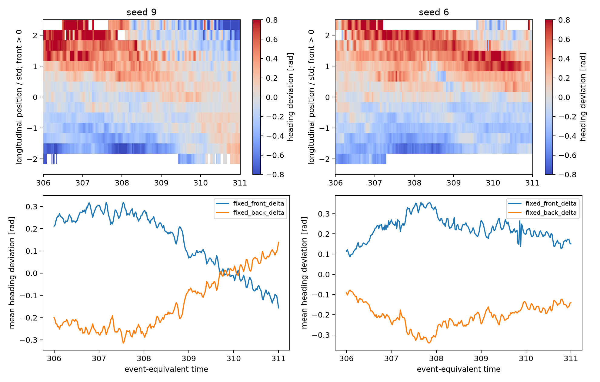

# Connected circulation: local amplification or transport?

## Verdict

**There is no sustained local amplification of the tested connected-circulation direction during the precursor.** The full microscopic response is positive at seed-9 `t=306`, but negative at `308, 309, 310, 311`, becoming more negative while the connected circulation reverses. The positive response at 306 is real and exceeds all seven matched initial controls; it must not be hidden. It is an isolated conditional response, however, not a demonstrated transition instability. Positive responses also occur at nine of the 35 subsequent/control snapshots.

The exact visual weights favor neighbors ahead. Their first spatial moment therefore permits backward communication of heading disturbances in an aligned school. The archived heading pattern is **consistent with reorganization/transport of a finite disturbance**, rather than sustained amplification along the tested direction. It does **not** prove transport alone, establish a propagation speed, or exclude a brief earlier amplification or another perturbation direction. Stop this bounded test here; no additional feature search, potential, or parameter sweep is performed.

## Scope and controls

We use the five requested seed-9 times and the seven stable-schooling windows already selected in [connected_circulation](../REPORT.md). Control starts are seeds 0–6 at `340,140,540,390,200,530,590`; each is evaluated at offsets `0,2,3,4,5`. Initial polarization, signed circulation, COM distance and school radius were matched previously; these are **initially matched windows**, not separately rematched states at every later time. They remain schooling by construction, so this is a retrospective mechanistic contrast, not a prospective accuracy estimate. Chirality reflection is inherited from the initial matching, not chosen using the future transition.

There are 40 base snapshots and 240 counterfactual full-RHS evaluations, with no trajectory integration. Headings change, positions do not. All direct and BEM hydrodynamic contributions and effective translation are recomputed for each trial heading; COM transport never uses an unchanged observed velocity for a perturbed state. The production timestep is 0.001, `Ip=4`, `In=0.5`, `N=100`, `R=7.158910531638177`.

## 1. Exact versus small-heading connected circulation

With COM polar angle `phi`, `Theta=arg p`, and `delta=wrap(theta−Theta)`,

\[
K=\Im\{\langle e^{i\theta-i\phi}\rangle-pA_1\},\qquad
K_{\rm small}=\operatorname{Cov}(\delta,\cos(\Theta-\phi)).
\]

The exact identity underlying the approximation is

\[
K=\operatorname{Cov}(\cos\delta,\sin(\Theta-\phi))
 +\operatorname{Cov}(\sin\delta,\cos(\Theta-\phi)).
\]

The first covariance is second order; replacing sine by its argument gives the requested approximation. We use covariance with divisor N, not N−1.

| Seed-9 time | Exact K | Small-heading K |
|---|---:|---:|
| 306 | +0.17975 | +0.19015 |
| 308 | +0.22060 | +0.23531 |
| 309 | +0.08589 | +0.10113 |
| 310 | −0.01032 | −0.00039 |
| 311 | −0.12857 | −0.12544 |

This supports a fore–aft heading-correlation interpretation, but not exact replacement of K by the approximation. Event RMS deviations are 0.345–0.466 radians and the largest individual deviation reaches 1.60 radians. Maximum approximation error is 0.01524 in the event snapshots and 0.06301 in controls. Relative error near K=0 is especially misleading. The perturbation test always uses **exact K**.



## 2. What alignment linearization is actually exact?

The source `GetVoronoi` builds an undirected Delaunay graph from positions. There is no hard heading-dependent visibility cutoff in this circular implementation. On an edge, `GetVision` uses

\[
W_{ij}=\frac{1+\cos(\beta_{ij}-\theta_i)}
 {\sum_{k\in\mathcal N_i}[1+\cos(\beta_{ik}-\theta_i)]},\qquad
\Omega_i^{\rm align}=I_p\sum_j W_{ij}\sin(\theta_j-\theta_i).
\]

Rows sum to one, entries are nonnegative, and self-weights vanish. Thus `Ip(W−I)` has nonpositive eigenvalue real parts (maximum numerical real part `1.93e-15`). **It is the exact alignment linearization at a synchronized heading**, using weights evaluated at that heading. The synchronized identity is verified to `1.34e-15`, and by an independent numerical Jacobian to `5.59e-10`.

It is **not the exact archived-state Jacobian**. For an imperfectly aligned state,

\[
J_{ij}=I_pW_{ij}\cos(\theta_j-\theta_i)\quad(j\ne i),
\]
\[
J_{ii}=-I_p\sum_jW_{ij}\cos(\theta_j-\theta_i)
 +I_p\sum_j(\partial_{\theta_i}W_{ij})\sin(\theta_j-\theta_i).
\]

The derivative of the weights must be included. This exact Jacobian agrees with numerical differentiation to `1.75e-8`. It has a positive largest real eigenvalue in **10/40** archived configurations, including seed-9 `t=309` and `311` (0.229 and 0.178). Positive eigenvalues also occur in stable controls. These frozen, generally nonequilibrium alignment-only Jacobians are not the stability spectrum of the evolving full school. Therefore the stronger claim that the actual archived-state alignment Jacobian is always `Ip(W−I)` and nonpositive is **rejected**.

## 3. Constrained perturbation and full source response

At fixed positions, define

\[
g_i=\partial_{\theta_i}K=\frac1N\Re[e^{i\theta_i}(e^{-i\phi_i}-A_1)],\qquad
D=\frac1N\begin{pmatrix}-\sin\theta_i\\\cos\theta_i\end{pmatrix}.
\]

Project `g` onto `ker D`, using an SVD, and normalize the result to unit RMS to obtain h. Its sign is chosen by `g·h>0`. This preserves both components of p to first order, not just its magnitude. No direction is fitted to outcomes. The same construction is used in every control.

For `epsilon=0.0005,0.001,0.002`, the measured quantity is

\[
R_k=\frac{b_{K,k}(\theta+\epsilon h)-b_{K,k}(\theta-\epsilon h)}
 {K(\theta+\epsilon h)-K(\theta-\epsilon h)}.
\]

It is a **directional coordinate response**, not an eigenvalue. Positive R means an increased K has a more positive instantaneous K drift locally, along this particular direction. It does not mean the unperturbed K must be increasing. Positions, the graph, and h are held fixed across the pair; visual weights, hydrodynamics, velocities, and COM angular transport are recomputed.

| Event time | Full R | Exact finite-step R | Matched control mean [range] | Event minus control, 95% control-seed interval |
|---|---:|---:|---|---|
| 306 | +0.3625 | +0.3470 | −2.1608 [−4.3746, −0.8644] | +2.5232 [1.8537, 3.3564] |
| 308 | −0.4012 | −0.4531 | −0.3842 [−2.5159, 2.4022] | −0.0170 [−1.1839, 1.0790] |
| 309 | −2.2250 | −2.2668 | −1.3943 [−3.3891, 0.3036] | −0.8306 [−1.7107, 0.1005] |
| 310 | −2.3127 | −2.3638 | −2.0852 [−2.9554, −1.1446] | −0.2275 [−0.6511, 0.1789] |
| 311 | −2.9978 | −3.0489 | +0.5052 [−1.5236, 3.5644] | −3.5029 [−4.6941, −2.5175] |

Intervals resample the seven independent **control seeds** 10,000 times; event uncertainty is not estimable from one transition. These are pointwise descriptive intervals, not multiplicity-adjusted transition-population tests. Averaging the five specified snapshots within each seed first gives event R=−1.5148 versus controls −1.1039, difference −0.4110 with control-seed interval [−0.7661,−0.0872]. This equal-snapshot average is not a time-integrated growth exponent. There is no evidence here of an unusually amplifying precursor across the tested window, although the isolated t=306 contrast is positive.

The exact finite-step column evaluates the production Euler update with the analytically averaged Gaussian angular noise and deterministic post-position COM geometry. It confirms the signs without assuming continuous-time linearization remains exact over one timestep.

### Source attribution

| Source response | 306 | 308 | 309 | 310 | 311 |
|---|---:|---:|---:|---:|---:|
| Alignment | −0.757 | −0.877 | −0.403 | −0.153 | −0.398 |
| Attraction | −0.020 | −0.032 | +0.027 | +0.016 | −0.010 |
| Wall | −0.131 | −0.068 | −0.045 | −0.050 | −0.047 |
| Direct hydrodynamics | +1.417 | +0.717 | −1.675 | −2.008 | −2.459 |
| BEM hydrodynamics | −0.0012 | −0.0011 | −0.0007 | −0.0003 | +0.0002 |
| COM geometry | −0.020 | −0.015 | −0.003 | +0.007 | +0.042 |
| Angular diffusion | −0.125 | −0.125 | −0.125 | −0.125 | −0.125 |
| Clipping | 0 | 0 | 0 | 0 | 0 |

Direct hydrodynamics supplies the positive local contribution at 306, but becomes the dominant negative contribution as K reverses. Alignment's directional contribution is negative at all five event states. This does not conflict with positive eigenvalues in other alignment directions.

For an angular source, `b_K,k=g(theta)·Omega_k(theta)`. Its derivative includes **both** `g·J_k h` and `(D_h g)·Omega_k`. `responses.csv` also records the frozen-projection torque-only contribution. For example, at 308 the full hydrodynamic coordinate response is +0.717, but its frozen-projection torque response is −0.330. Thus interpreting every positive source response as amplifying torque feedback would be incorrect. At 306 the direct-hydro frozen-projection response is +0.892: the early positive contribution is not exclusively a projection artifact, but neither is it a stability eigenvalue.



### Numerical checks

- Replayed effective velocities match stored `rdot[:,:,step+1]` to `4.45e-16`; source torque components match the established replay exactly.
- Source-exact W reproduces the alignment contribution to `4.46e-14`.
- `max|Dh|=2.64e-16`. Trial changes in p are at most `1.94e-6`, consistent with second-order preservation; the maximum central first-derivative residual is `3.87e-7` at epsilon=0.002.
- Across the three epsilons, maximum full-R change is `1.36e-4`, and maximum individual-source change is `1.48e-4`. All event-response signs are unchanged.
- No base or trial snapshot clips angular turning; no graph, collision, extreme-velocity, or position-safety override changes occur. Visual weights change smoothly (maximum entry change 0.00574); they were not frozen in the full-RHS test.

## 4. Is the heading disturbance transported front to back?

The exact vector `a_i=sum_j W_ij(x_j−x_i)` is saved for every snapshot. Its projection onto the mean heading is positive for **88–96%** of fish across the tested states. Mean projection is positive in all 40 snapshots (0.142–0.221). In seed 9 it is 0.1555, 0.1856, 0.2031, 0.2206, 0.2113 at the five times. This forward-neighbor bias is generic, not event-specific.

For a smooth small heading disturbance at frozen geometry,

\[
\partial_t\delta_i\simeq I_p\sum_jW_{ij}(\delta_j-\delta_i)
 \simeq I_p\,a_i\cdot\nabla\delta+\text{higher spatial moments}.
\]

The characteristic direction of the first-order term is **−Ip a_i**: information can move from front to back even though the neighbors sampled lie ahead. This is a local Taylor interpretation, not a measured propagation speed. Particle motion, time-varying weights, the rotating mean-heading reference, other torques, and finite heading deviations all remain in the real dynamics. Nonpositive eigenvalues of a directed consensus operator also do not exclude transient growth in every chosen norm.

We inspect the five-unit archived windows every 0.02. The kymograph shows the redistribution and reversal of seed 9's finite fore–aft heading pattern; the nearest initial matched reference, seed 6, also exhibits a moving positive-heading patch without transitioning. Fixed front/back membership is assigned at the initial time and retained, alongside rolling-group diagnostics in the CSV, so replacement of fish is not mistaken for turning. Kymograph bins use instantaneous longitudinal position normalized by its instantaneous standard deviation; patch motion in that plot is not itself a material velocity.



These patterns are **compatible with transport**, but they do not identify a unique propagating front. At fixed lags −0.5, −0.2, 0, +0.2, +0.5, seed-9 front/back correlations are −0.934, −0.965, −0.997, −0.971, −0.950. Their strongest magnitude is at zero lag, not a delayed front-to-back signal. Moreover, defining deviations relative to the collective heading constrains their mean sine to zero, so opposite front/back means are not independent evidence of propagation. We do not infer a speed or causality from these correlations.

**Stopping conclusion:** the data support finite heading–position reorganization with generic directed visual coupling and mostly negative local K response during the reversal. They do not support a sustained event-specific amplifying K mode. The early t=306 positive response remains a bounded observation, not something to erase or extrapolate. “Merely transported” is stronger than the evidence: transport is consistent with the observations, not uniquely established. No further sweep or diagnostic search is launched.

## Reproduction and outputs

Run from the repository root:

```bash
OPENBLAS_NUM_THREADS=1 VECLIB_MAXIMUM_THREADS=1 MPLCONFIGDIR=/tmp/mplconfig \
uv run --with numpy --with scipy --with matplotlib python \
  theory/circle_collective_first_stage/connected_circulation/local_response/analyze_local_response.py \
  --data-dir /Volumes/data/BEM_bichamber/archive_one_R_60/BEM_data
```

The production source is the unchanged archive-parent `BEM_circular_parallel_instance.py` (`GetVoronoi`, `GetVision`, `GetHydro`, `GetHydroBEM`, `GetWallAvoid`, `Check_jumping`, clipping and positional retry); SHA256 is recorded in `outputs/audit.json`. Replay is checked against `theory/circle_collective_first_stage/com_relative_turning/analyze_com_relative_turning.py`. No MAT files or original simulator files are modified.

`states.csv` contains approximation, spectral, projection and transport diagnostics; `responses.csv` contains every epsilon/source result; `convergence.csv` and the two `*contrasts.csv` files contain convergence and seed-level uncertainty. `weights_directions.npz` retains exact visual matrices, neighbor-displacement vectors and perturbation directions. The compact transport CSV/NPZ contains only derived heading summaries, not raw trajectories. The three figures above are the complete figure set.
