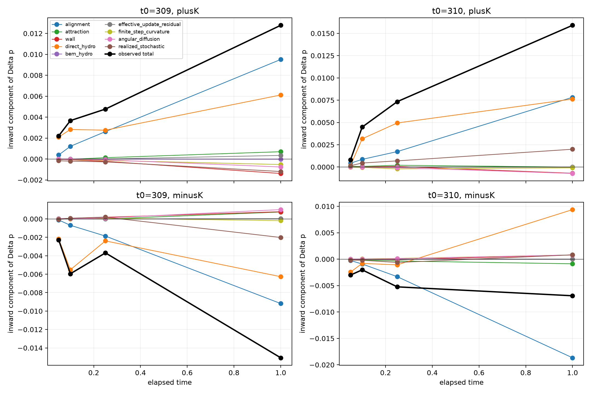
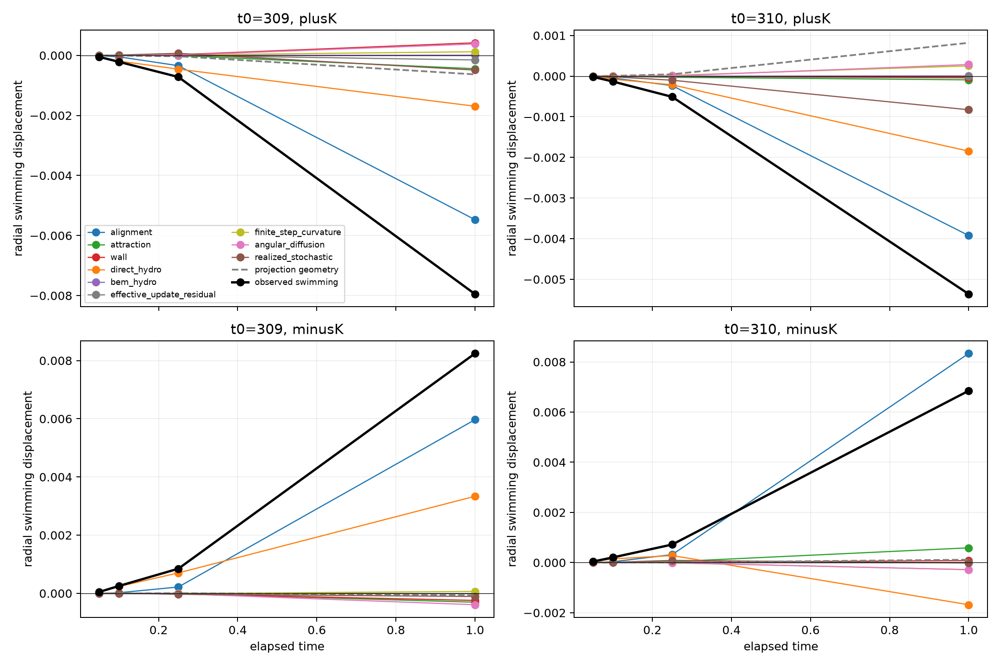

# Source-exact polarization mechanism behind the radial reversal

## Verdict

The bounded branching ensemble supports a coherent **coupled hydrodynamic-turning/alignment mechanism**, but not an independently causal single torque source.

1. A `K`-directed heading perturbation preserves the initial complex polarization exactly, yet it changes both direct-hydrodynamic translation and direct-hydrodynamic angular velocity because headings are attached to particular fish positions.
2. The initial direct-hydrodynamic COM translation has the opposite radial sign from the eventual displacement, as established previously. At the same time, the **direct-hydrodynamic angular torque usually turns the polarization toward the eventual swimming response within 0.05–0.1 time units**.
3. Visual alignment then spreads and maintains that reorientation. At `tau=0.1`, its polarization contribution has the expected `+K`/`-K` sign in all 48 branch realizations (two initial states, two signs, three prespecified perturbation directions, four noise blocks). Direct-hydrodynamic turning has that sign in 42/48 and is larger on average in three of the four state/sign groups.
4. Consequently, the altered mean swimming direction and the evolving direct-hydrodynamic translation acquire the final radial sign, reversing the initial COM kick. Wall turning, attraction, and BEM-mediated turning are small in this ensemble.
5. By one time unit the source balance is no longer universal. In the `t=310,-K` group, alignment sustains the response while direct-hydrodynamic turning opposes it. Noise and unresolved perturbation-direction dependence also grow. Thus the mechanism is a short-time causal response of the full microscopic dynamics, not a closed law in `K`.

This is exact source accounting along the already defined counterfactual trajectories. It is **not** a torque-source ablation: the result does not prove that direct hydrodynamics or alignment is independently necessary or sufficient.

## 1. Exact complex-polarization equation

Let

```text
z_i = exp(i theta_i),             p = (1/N) sum_i z_i,
d theta_i = Omega_i dt + In dW_i,
Omega_i = sum_k Omega_i^(k).
```

Itô's formula gives

```text
dp = [sum_k i <z Omega^(k)> - (In^2/2) p] dt
     + (i In/N) sum_i z_i dW_i,
```

where `k` is alignment, attraction, wall avoidance, direct hydrodynamic turning, and BEM-mediated turning. The term `-(In^2/2)p` is angular-diffusion decorrelation. The final term is a complex martingale with zero conditional mean.

The production simulator uses an Euler heading update with effective angular rate `Omega_eff`, after its clipping and collision/extreme-velocity overrides,

```text
theta_i' = theta_i + Omega_eff,i dt + xi_i,
xi_i = In sqrt(dt) Normal(0,1).
```

The analysis uses the following **exact finite-step additive identity**, rather than pretending that a first-order continuous budget closes a finite step:

```text
Delta p_k       = dt <i z Omega^(k)>,
Delta p_update  = dt <i z (Omega_eff - sum_k Omega^(k))>,
Delta p_curve   = <exp[i(theta+Omega_eff dt)]>-p
                  -dt <i z Omega_eff>,
p_star          = <exp[i(theta+Omega_eff dt)]>,
Delta p_diff    = [exp(-In^2 dt/2)-1] p_star,
Delta p_stoch   = p' - exp(-In^2 dt/2) p_star.
```

Their sum is the measured `p'-p` exactly. `Delta p_update` retains clipping/override effects without assigning them arbitrarily to a physical torque. `Delta p_curve` contains finite-step curvature and cross-terms. `Delta p_stoch` has zero conditional mean, although paired trajectories receiving the same Gaussian draws can have a nonzero realized *difference* because their headings differ.

## 2. Scope and validation

This analysis replays the existing stochastic-branching ensemble only:

- archived seed-9 initial states at `t=309` and `t=310`;
- the same three prespecified `+K` and three `-K` perturbation directions;
- the same four Gaussian noise sequences at each state;
- one native-time-unit integration, `dt=0.001`;
- unchanged production interactions, BEM solve, wall law, clipping, collision logic, and position-safety retry.

No new intervention, parameter sweep, fitted coordinate, potential, or surrogate was introduced. The instrumented replay reproduced every stored branching collective metric exactly: maximum difference `0`. Same-noise duplicate baselines were identical. Maximum finite-step complex-polarization closure error was `5.72e-17`.

There were no wall clips, collisions, or position-safety candidates. Four angular-clip fish-steps occurred, all retained under the production rule. Their contribution appears in `effective_update_residual`; it is zero to roundoff elsewhere.

For uncertainty, the three prespecified microscopic perturbation directions are first averaged within each independent noise block. Tables report the mean and standard deviation across the four noise blocks. Direction ranges remain in the CSV. The two initial states are not treated as a large statistical ensemble.

## 3. Early source-resolved polarization response

To connect turning to approach, each complex contribution is projected onto the inward radial direction at the initial COM. Positive values denote an inward change for `+K`; the `-K` response is expected to have the opposite sign.

### `tau=0.05`

| start | sign | measured inward `Delta p` | direct-hydro turning | alignment | realized stochastic |
|---:|:---:|---:|---:|---:|---:|
| 309 | + | `+0.002206 +/- 0.00085` | `+0.002094 +/- 0.00060` | `+0.000383 +/- 0.00011` | `-0.000169 +/- 0.00016` |
| 309 | - | `-0.002279 +/- 0.00060` | `-0.002153 +/- 0.00040` | `-0.000115 +/- 0.00010` | `-0.000065 +/- 0.00016` |
| 310 | + | `+0.000796 +/- 0.00033` | `+0.000153 +/- 0.00033` | `+0.000427 +/- 0.00014` | `+0.000143 +/- 0.00005` |
| 310 | - | `-0.003013 +/- 0.00044` | `-0.002447 +/- 0.00031` | `-0.000255 +/- 0.00012` | `-0.000186 +/- 0.00020` |

Direct-hydrodynamic turning has the expected sign in 44/48 individual branch realizations at `tau=0.05`; alignment does so in 41/48. Direct turning dominates three groups, while alignment is larger for `t=310,+K`. This prevents the stronger but unsupported claim that one source alone always initiates the turn.

### `tau=0.1`

| start | sign | measured inward `Delta p` | direct-hydro turning | alignment | realized stochastic |
|---:|:---:|---:|---:|---:|---:|
| 309 | + | `+0.003667 +/- 0.0030` | `+0.002823 +/- 0.0029` | `+0.001211 +/- 0.00020` | `-0.000205 +/- 0.00032` |
| 309 | - | `-0.005951 +/- 0.0019` | `-0.005515 +/- 0.0018` | `-0.000693 +/- 0.00006` | `+0.000076 +/- 0.00034` |
| 310 | + | `+0.004482 +/- 0.0019` | `+0.003168 +/- 0.0017` | `+0.000857 +/- 0.00037` | `+0.000448 +/- 0.00014` |
| 310 | - | `-0.002024 +/- 0.0018` | `-0.000800 +/- 0.0018` | `-0.000914 +/- 0.00019` | `-0.000205 +/- 0.00026` |

At `tau=0.1`, alignment has the expected sign in 48/48 branches, direct-hydrodynamic turning in 42/48, and the total response in 44/48. Attraction, wall, and BEM means are at least several times smaller than alignment/direct turning; BEM angular contributions are around `1e-6` in these projected units.

At `tau=0.25`, direct turning and alignment remain comparable reinforcements. At `tau=1`, their balance becomes state dependent: for `t=310,-K`, alignment contributes `-0.01867` while direct turning contributes `+0.00938`, opposing the retained `-K` response. This is evidence for a dynamical handoff and cancellation, not a constant growth rate or a one-dimensional instability.



## 4. Exact connection to COM transport

The previously validated translation identity is

```text
dC/dt = (Re p, Im p) + <U_direct> + <U_BEM> + override residual.
```

Because all perturbations preserve the initial complex `p`, their instantaneous swimming-velocity contrast is zero. Their initial COM-velocity contrast is therefore direct-hydrodynamic translation and has the opposite sign from the eventual radial displacement.

The new budget explains how a swimming contrast subsequently appears. Let `Delta p_k(n)` be the cumulative branch-minus-baseline polarization contribution from source `k`. Then the exact vector swimming-displacement response is

```text
Delta C_swim(T) = dt sum_n [p_branch(n)-p_base(n)]
                = sum_k dt sum_n Delta p_k(n).
```

For the exact scalar-radius budget, the same cumulative contributions are projected with the branch chord vector

```text
g_n = [C_n+C_(n+1)]/[|C_n|+|C_(n+1)|].
```

A separate projection-geometry residual accounts for the difference between the branch and baseline chord directions. This reconstructs the measured radial swimming response to `1.48e-15`.

At `tau=0.1`, the source-resolved radial swimming responses are:

| start | sign | measured swimming | from direct-hydro turning | from alignment |
|---:|:---:|---:|---:|---:|
| 309 | + | `-2.16e-4` | `-1.89e-4` | `-4.69e-5` |
| 309 | - | `+2.56e-4` | `+2.38e-4` | `+2.13e-5` |
| 310 | + | `-1.32e-4` | `-7.35e-5` | `-4.56e-5` |
| 310 | - | `+2.05e-4` | `+1.47e-4` | `+3.29e-5` |

Thus, by `tau=0.1`, turning produced by direct hydrodynamics plus alignment has generated a swimming displacement with the eventual sign in every state/sign group. The previous exact transport budget independently showed that direct translational hydrodynamics has also changed to that sign by this time. The supported causal sequence is:

```text
position-dependent K perturbation
    -> instantaneous direct-hydrodynamic translation (opposite final sign)
    + direct-hydrodynamic angular response
    -> alignment-mediated collective reorientation
    -> altered mean swimming direction and reorganized direct hydro
    -> radial sign reversal and persistent displacement.
```



## 5. What is established and what is not

### Established by exact identities and numerical replay

- The microscopic polarization equation and finite-step source identity above.
- Exact reconstruction of every polarization step and the induced swimming displacement.
- The early reorientation is supplied mainly by direct-hydrodynamic turning and alignment in this bounded ensemble.
- Wall, attraction, and BEM turning do not explain the systematic early response here.
- The initial translational hydro kick and the early angular hydro response are different projections of the same full microscopic interaction and can have different radial consequences.

### Supported causally by the existing intervention

- Changing the position-attached heading structure along the prespecified `K` directions causes a reproducible early polarization and COM response under paired noise.
- The short-time response is consistent across both initial states at the ensemble level, but not every direction/noise realization has the same source magnitude.

### Not established

- Source accounting is not source ablation. Direct hydrodynamics and alignment are coupled through the changing state; neither has been shown independently necessary or sufficient.
- These one-second branches do not estimate transition probabilities or reproduce the archived natural transition.
- `K` is not sufficient: direction-to-direction differences from unresolved position-heading structure remain substantial.
- No stability boundary, autonomous reduced equation, effective potential, or long-time milling prediction follows from this result.

## 6. Predictions and stopping conclusion

The mechanism makes two limited, testable predictions at comparable schooling states:

1. A small polarization-preserving perturbation with the same position-attached `K` sign should produce an immediate direct-hydrodynamic angular response, followed within roughly `0.1` time units by an alignment contribution of the same collective-turning sign.
2. Removing or altering either hydrodynamic turning or alignment while holding the instantaneous state fixed would change the reversal chronology, but the present accounting does not predict the ablated trajectory quantitatively.

The requested analysis stops here. A consistent microscopic mechanism is supported for the **short-time radial reversal**: hydrodynamic turning initiates most of the early mean-direction change and visual alignment reinforces/propagates it. The evidence does not justify elevating either budget term to an independently causal instability mechanism, nor does it establish that this reversal causes the natural schooling-to-milling transition.

## Reproduction and files

Run from the repository root:

```bash
OPENBLAS_NUM_THREADS=1 VECLIB_MAXIMUM_THREADS=1 \
MPLCONFIGDIR=/tmp/mplconfig UV_CACHE_DIR=/tmp/uv-cache \
uv run --offline --with numpy --with scipy --with matplotlib python \
  theory/circle_collective_first_stage/connected_circulation/polarization_source_mechanism/analyze_polarization_sources.py \
  --data-dir /Volumes/data/BEM_bichamber/archive_one_R_60/BEM_data \
  --stage all --workers 4
```

Important outputs:

- `polarization_interval_budget.csv`: every branch, interval, and complex source contribution;
- `polarization_source_summary.csv`: direction-averaged, noise-block uncertainty and direction ranges;
- `source_resolved_swimming_transport.csv`: exact source-to-swimming double integral;
- `finite_step_audit.csv` and `simulation_audit.json`: closure, replay, duplicate, cost, and safeguard audit;
- compact trajectory NPZ files: collective metrics and source increments only, not raw MAT trajectories.

The eight replay blocks required 683 seconds on four workers.
