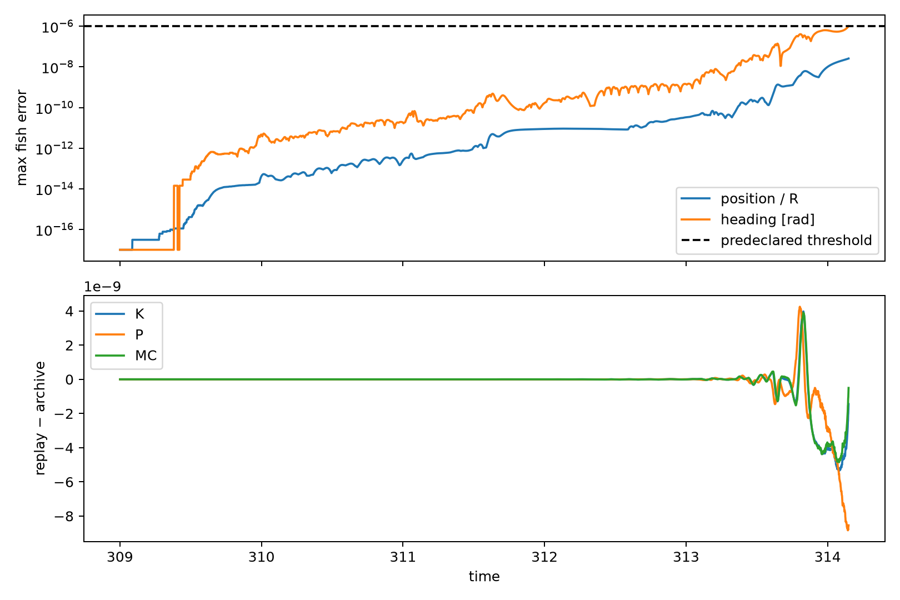

# Same-noise causal counterfactual: baseline validation failure

## Outcome

**The required autonomous baseline replay failed the predeclared heading-accuracy gate at `t=314.148`. The K perturbations and control perturbations were therefore not constructed or integrated. This experiment provides no causal evidence for or against connected circulation.**

The failure is numerically subtle, not a gross error in the reconstructed equations:

- Source-anchored one-step positions agree with the archive to `8.88e-16`; replay velocities agree with stored `rdot[:,:,step+1]` to `1.42e-14`.
- Recovered angular increments round-trip the stored headings exactly in double precision when each step is anchored to the archived state.
- Starting once at `t=309` and replaying without state resets, the maximum circular heading error first exceeds `10^-6` radians at `t=314.148`: `1.0089e-6` radians.
- At the same instant, maximum per-fish Euclidean position error is `1.8550e-7`, still below its tolerance `10^-6 R = 7.1589e-6`.
- The run stopped immediately at that first heading violation, after 5,148 autonomous steps. The requested interval extends to `t=320`, so the full baseline was not validated.
- The saved verdict explicitly records `counterfactuals_run=false`.



The lower panel shows that collective-observable errors remain much smaller than the per-fish gate at failure: maximum errors before stopping are `5.36e-9` in K, `8.83e-9` in P, and `4.85e-9` in signed COM circulation. That does **not** authorize the counterfactual. The causal comparison requires microscopic trajectory fidelity because perturbed hydrodynamic and visual interactions depend on every fish state.

## Exact reconstruction

For archived step n, the recovered per-fish angular increment is

\[
\xi_i^n=\theta_i^{n+1}-(\theta_i^n+\Delta t\,\Omega_{i,\mathrm{effective}}^n).
\]

The parentheses reproduce the source addition order. The increments are not wrapped, smoothed, rescaled, or replaced by fresh random values. They represent the stored realization of `In*dW`, up to the deterministic replay's floating-point arithmetic; they are not claimed to recover the original random-number-generator bits.

Across all 1,100,000 reconstructed fish-steps from `t=309` to `320`, their mean is `−7.12e-6` and standard deviation is `0.01581246`. The production value is

\[
I_n\sqrt{\Delta t}=0.5\sqrt{0.001}=0.01581139.
\]

The observed maximum absolute increment is `0.07762`. These statistics are a consistency check only; Gaussian-looking increments do not validate the autonomous replay.

## How the production step was preserved

The unchanged source is the archive-parent `BEM_circular_parallel_instance.py`, SHA256
`2a415d26ad83cf42a2f3cb0f4ba156b8dd6c11b32972ce8305499eebced22da4`.

Rather than manually reimplementing the dynamics, `replay_baseline.py` parses `step_Computation` and extracts its actual one-step statements. The only physical-input substitution is replacing `wNoise=GetNoise(para)` with the supplied archived increment. The generated [extracted step](outputs/extracted_production_step.py) is saved for inspection. It retains:

- direct and BEM hydrodynamic translation and turning;
- Delaunay visual interactions and the original wall law;
- original torque summation and clipping order;
- collision and extreme-velocity hydrodynamic overrides;
- the positional wall-safety retry;
- the production convention that `rdot[:,:,n+1]` advances `state[:,:,n]`.

The wall-safety variable `dis_last` stores the previous **pre-retry proposed** signed distance in production. It was reconstructed from the archived `t=308.999` state and then carried autonomously. No clipping, collision override, or wall-safety candidate occurred before the baseline stopped, so the failure is not caused by a branch mismatch in those safeguards.

The extracted step SHA256 is `75db436b0154d288f2eaf432bb0a17cd692a62ce9c746bb7533bb72ddbf116f6`. Original simulator and MAT files were not modified.

## Error growth and failure interpretation

The autonomous maximum heading error crosses:

| Error | First time |
|---:|---:|
| `1e-12` rad | 309.919 |
| `1e-10` rad | 311.512 |
| `1e-8` rad | 313.352 |
| `1e-7` rad | 313.623 |
| `1e-6` rad | **314.148** |

Maximum position error crosses `1e-12`, `1e-10`, `1e-8`, and `1e-7` at times 310.556, 312.723, 313.758, and 314.036. The irregular approximately exponential envelope is consistent with sensitive amplification of microscopic floating-point differences. It is not a measured Lyapunov exponent.

Why can this happen when anchored one-step checks are so accurate? The original trajectory's exact numerical runtime is not archived and is not guaranteed to match this one. Each BEM solve, LU operation, and vectorized summation can differ at roundoff level. During anchored reconstruction, the inferred angular increment absorbs the deterministic heading discrepancy at that archived state, and the next position differs only at roundoff. During autonomous replay, position differences are not corrected. They change subsequent hydrodynamic, social, wall, and COM geometry inputs; the reconstructed increment cannot cancel a deterministic discrepancy evaluated at a different state. The errors then amplify.

Runtime used here was Python 3.14.5, NumPy 2.5.4, SciPy 1.18.1 on macOS 15.6.1 arm64, with numerical-library thread counts set to one. The original run's exact Python/NumPy/SciPy/BLAS/LAPACK versions, LU serialization path and floating-point environment were not archived. Even matching versions would need validation rather than an assumption of bitwise identity.

This explanation is supported by the observed numerical pattern, but “chaos” is not proven: no Lyapunov analysis was performed, and none is needed for the stopping decision.

## Predeclared gate and scientific stopping decision

The [protocol](PROTOCOL.md) was written before the autonomous result. It required, at every native step through `t=320`:

- maximum Euclidean position error no larger than `10^-6 R`;
- maximum circular heading error no larger than `10^-6` radians.

It also specified: stop at the first violation; do not loosen tolerances, re-anchor, alter recovered noise, or proceed to perturbations. The heading gate failed. Consequently:

- no minimum-norm ±0.02 K perturbations were constructed;
- no equal-RMS zero-first-order-K controls were constructed;
- no perturbed trajectory was integrated;
- no claim is made about advancing, delaying, or preventing milling;
- no causal conclusion about K is possible from this experiment.

Re-anchoring the baseline would suppress the state divergence that the causal experiment needs to expose and would not define an autonomous counterfactual. Relaxing the tolerance after seeing the failure would invalidate the predeclared gate. Comparing perturbed trajectories only to a drifting reconstructed baseline could be a different shadowing experiment, but it is not the requested validated replay and is not attempted here.

## Numerical cost and outputs

The bounded attempt used:

- 11,000 source-exact full-BEM evaluations to reconstruct increments: 453.0 seconds;
- 5,148 autonomous full-BEM steps before stopping: 210.1 seconds;
- total measured runtime: 663.1 seconds on one process with numerical-library threads set to one;
- zero counterfactual integrations.

Compact derived outputs are under `outputs/`: `reconstruction_audit.json`, `baseline_verdict.json`, `error_growth_summary.json`, sampled `anchored_reconstruction.csv`, full native-step `baseline_replay.csv`, the recovered-increment NPZ, the extracted source step, and the validation figure. No raw trajectory is copied.

Reproduce from the repository root with:

```bash
OPENBLAS_NUM_THREADS=1 VECLIB_MAXIMUM_THREADS=1 \
MPLCONFIGDIR=/tmp/mplconfig UV_CACHE_DIR=/tmp/uv-cache \
uv run --offline --with numpy --with scipy --with matplotlib python \
  theory/circle_collective_first_stage/connected_circulation/same_noise_counterfactual/replay_baseline.py \
  --data-dir /Volumes/data/BEM_bichamber/archive_one_R_60/BEM_data
```

If the cached reconstruction is present and source hashes match, the script reuses it and reruns only the autonomous validation. It will again stop at the first predeclared violation. This analysis deliberately ends at the failed baseline rather than manufacturing a causal result.
