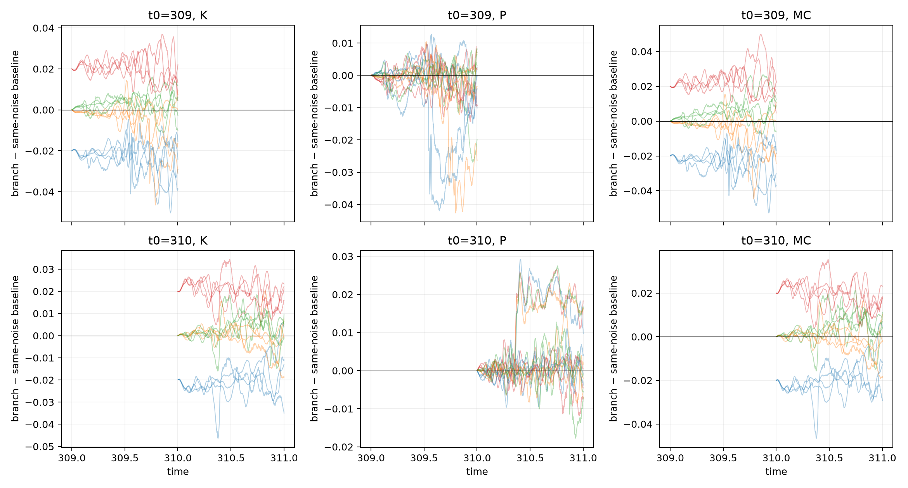
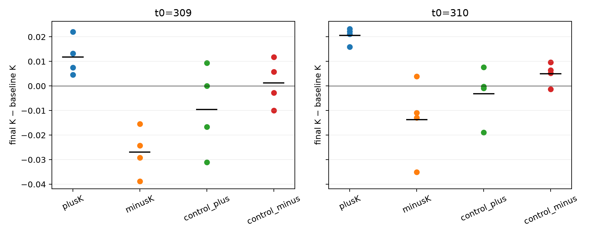
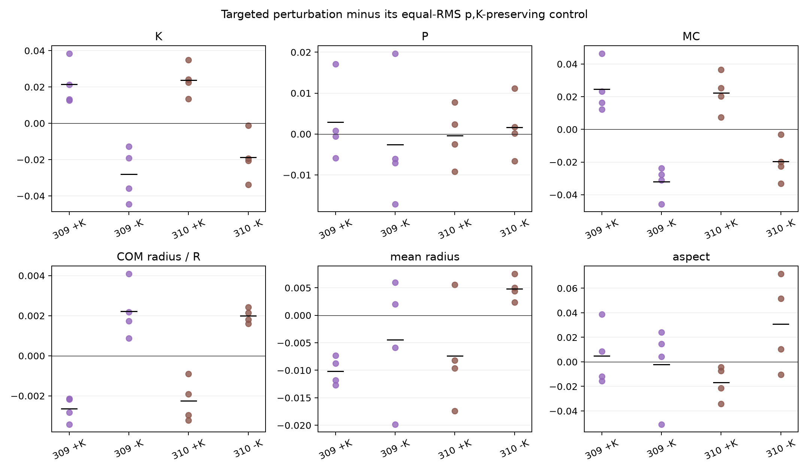

# Source-exact stochastic branching of connected circulation

## Verdict

This bounded experiment finds a **reproducible causal influence of the imposed connected-circulation coordinate `K` over one time unit**, at both archived seed-9 initial states (`t=309` and `t=310`). The conclusion is deliberately limited:

- The imposed `+0.02` and `-0.02` changes initially grow in magnitude during the first `0.1–0.25` time units under the unchanged microscopic dynamics.
- Their signed, one-second time-integrated responses remain distinct from equal-RMS heading controls in all four fresh-noise realizations at both initial states.
- Endpoint retention is not uniformly amplifying. It depends on the initial state and noise realization: mean endpoint gain ranges from `0.59` to `1.34`, and the `t=310, -K` endpoint is especially variable.
- The response appears strongly in signed COM circulation, as expected from its exact decomposition, but not reproducibly in global polarization. There is a smaller, sign-consistent displacement of the COM radial geometry.

Thus `K` is not merely an instantaneous drift label: changing it while holding positions and complex polarization fixed causes a persistent, signed divergence under common noise. This does **not** show that `K` causes the archived schooling-to-milling transition, establish a transition probability, or demonstrate an unstable eigenmode.

The earlier historical same-noise replay remains a failed experiment. Its predeclared microscopic replay gate failed at `t=314.148`; its tolerance is not relaxed, and that run is not reinterpreted. This new experiment asks a different, valid Markov-branching question using fresh noise from archived states rather than claiming to shadow the historical realization. See [the preserved failure report](../same_noise_counterfactual/REPORT.md).

## Experimental construction

For COM polar angles `phi_i`, headings `theta_i`, complex polarization `p`, and `A1 = mean(exp(-i phi_i))`, the coordinate is

```text
K = Im{ mean[exp(i theta_i - i phi_i)] - p A1 }.
```

At each archived initial state, positions are fixed and headings are changed by solving constrained nonlinear problems. The targeted perturbations minimize heading RMS subject to

```text
p(theta + delta) = p(theta)                 (both real components),
K(theta + delta) = K(theta) +/- 0.02.
```

Two controls use fixed pseudorandom trial directions and preserve both `p` and `K` exactly while matching the corresponding targeted perturbation's heading RMS. They are not outcome-fitted. The achieved constraints are:

| Start | Perturbation | Delta K | heading RMS (rad) | max absolute heading (rad) |
|---:|---|---:|---:|---:|
| 309 | +K | +0.0200000000000 | 0.02649 | 0.05334 |
| 309 | -K | -0.0200000000000 | 0.02600 | 0.04717 |
| 310 | +K | +0.0200000000000 | 0.02573 | 0.03479 |
| 310 | -K | -0.0200000000000 | 0.02582 | 0.03831 |

The largest complex-polarization constraint error is `4.97e-14`; the largest targeted/control `K` constraint error is `1.22e-14`. Equal-RMS constraints agree to `2.4e-15` rad. Initial positions are unchanged.

The initial collective states differ materially:

| Start | K | P | signed COM circulation | COM radius / R | mean COM-relative radius |
|---:|---:|---:|---:|---:|---:|
| 309 | +0.08589 | 0.93280 | +0.12916 | 0.39792 | 1.40921 |
| 310 | -0.01032 | 0.94350 | +0.01404 | 0.32710 | 1.46431 |

For each start, four independent PCG64 Gaussian sequences are generated with the production convention `In sqrt(dt) N(0,1)`, where `In=0.5` and `dt=0.001`. Within one realization, baseline, `+K`, `-K`, and both controls receive exactly the same per-fish increment at every step. Each branch is integrated for 1,000 native steps. This gives eight independent-noise blocks and 48 branch integrations including duplicate baselines.

## Source and complete numerical state

The analysis extracts the actual production step from `BEM_circular_parallel_instance.py` rather than rewriting its physics. The source SHA256 is `2a415d26ad83cf42a2f3cb0f4ba156b8dd6c11b32972ce8305499eebced22da4`; the extracted step SHA256 is `75db436b0154d288f2eaf432bb0a17cd692a62ce9c746bb7533bb72ddbf116f6`.

The replay retains direct and BEM hydrodynamic translation and turning, Delaunay visual interactions, wall avoidance, the original torque-clipping order, collision/extreme-velocity overrides, and the positional wall-safety retry. Besides the microscopic state, the production retry uses `dis_last`, the previous pre-retry proposed wall distance. It is reconstructed from archived step `n-1` and then evolved independently in every branch. Angular noise changes headings only, so reconstructing this positional memory does not require the unknown historical angular noise at the preceding step.

Two unperturbed copies were initialized identically in every fresh-noise block. Their maximum state difference over all 1,000 steps was **exactly zero** in all eight blocks. This validates deterministic repeatability of the new branching calculation; it does not repair or supersede the historical replay failure.

There were no collision overrides, position-safety candidates, or wall clips. The production angular clip was activated for 12 fish-steps among the nonduplicate integrations: 10 in perturbed/control branches and two in one `t=310` baseline. The identical duplicate had the same two clips. These steps are retained with the production rule, not removed. They are too rare to explain the systematic signed response, but they limit any smooth linear interpretation.

## Paired responses

All differences below use common noise. An equal-RMS control-adjusted response means targeted branch minus its corresponding control. Mean and sample SD are across four independent fresh-noise realizations; `n=4` is too small for a population-level distributional claim.

| Start | Contrast | final Delta K, mean +/- SD | integral Delta K dt, mean +/- SD |
|---:|---|---:|---:|
| 309 | +K - control | +0.02139 +/- 0.01205 | +0.02507 +/- 0.00555 |
| 309 | -K - control | -0.02812 +/- 0.01472 | -0.02587 +/- 0.00193 |
| 310 | +K - control | +0.02373 +/- 0.00874 | +0.01964 +/- 0.00225 |
| 310 | -K - control | -0.01878 +/- 0.01333 | -0.02364 +/- 0.00299 |

Every individual integrated response has the imposed sign. Every control-adjusted endpoint also has the imposed sign, although the `t=310, -K` endpoint approaches zero in one realization. Descriptive Student-t intervals for integrated responses exclude zero in all four contrasts; with only four noise samples, these intervals should not be mistaken for transition-population uncertainty.



### Amplification versus damping

Relative to the same-noise baseline, mean `K` differences at `tau=0.1` are:

| Start | +K | -K |
|---:|---:|---:|
| 309 | +0.02330 | -0.02332 |
| 310 | +0.02454 | -0.02412 |

The initial magnitude `0.02` therefore grows by roughly 16–23% over the first `0.1` time units, and remains near or above its imposed magnitude at `tau=0.25`. This is a finite-amplitude, finite-time causal response, not a stability eigenvalue. By `tau=1`, branch-versus-baseline gains are `0.59 +/- 0.38`, `1.34 +/- 0.49`, `1.03 +/- 0.16`, and `0.69 +/- 0.80` for `(309,+K)`, `(309,-K)`, `(310,+K)`, and `(310,-K)`. The correct classification is therefore **short-time local amplification followed by state- and noise-dependent persistence/damping**, not universal exponential growth.



### Transport into other collective variables

The exact identity is

```text
M_C = K + Im(p A1).
```

Because the perturbation fixes `p` and positions initially, its initial change in signed COM circulation equals its change in `K`. The subsequent `M_C` response remains close to the `K` response; this is expected coupling, not independent evidence of milling.

Control-adjusted final polarization changes are small and inconsistent: means lie between `-0.0026` and `+0.0029`, and all descriptive intervals span zero. No reproducible polarization collapse occurs in this one-unit pilot.

The COM radial position responds consistently: `+K` reduces COM radius by `0.00225–0.00264 R` relative to its control, whereas `-K` increases it by `0.00199–0.00222 R`. This is a small but directionally repeatable geometric consequence. Mean school radius changes by about `-0.0101` for `(309,+K)` and `+0.00482` for `(310,-K)`, but the other contrasts are not resolved. Aspect-ratio effects are inconsistent. Thus the main response remains in connected/signed circulation, with modest COM translation rather than a robust global shape or polarization conversion.



## Scientific interpretation and stopping decision

This experiment provides stronger evidence than the prior frozen-state directional derivative: an exact finite perturbation of `K` produces a signed, persistent trajectory separation under the full microscopic dynamics and common noise. Equal-RMS perturbations that preserve `p` and `K` do not reproduce that systematic integrated response. Within these two seed-9 states, `K` therefore has a **bounded causal role** in short-time collective angular organization.

What it does not establish is equally important:

1. The fresh-noise branches are not replays of the archived seed-9 transition.
2. One second and four noise realizations cannot estimate milling or transition probabilities.
3. The experiment starts from two nearby states on one trajectory, so it does not establish generality across seeds or parameter values.
4. Persistence of a deliberately imposed coordinate does not prove that spontaneous growth of `K` initiates the natural transition.
5. The controls test two fixed equal-RMS directions. They establish selectivity relative to those prespecified directions, not to every possible polarization-preserving heading perturbation.

The requested bounded pilot therefore stops here. The defensible result is: **`K` is dynamically consequential and briefly amplified locally, but this pilot does not identify it as the causal trigger of schooling-to-milling switching.**

## Reproduction and compact outputs

Run from the repository root with the archived data mounted at the specified path:

```bash
OPENBLAS_NUM_THREADS=1 VECLIB_MAXIMUM_THREADS=1 \
MPLCONFIGDIR=/tmp/mplconfig UV_CACHE_DIR=/tmp/uv-cache \
uv run --offline --with numpy --with scipy --with matplotlib python \
  theory/circle_collective_first_stage/connected_circulation/stochastic_branching/run_branching.py \
  --data-dir /Volumes/data/BEM_bichamber/archive_one_R_60/BEM_data --stage all --workers 4
```

`outputs/perturbations.csv` audits exact constraints. `simulation_audit.json` records hashes, run times, duplicate validation, and safeguards. `timepoint_*`, `paired_*`, and `control_adjusted_*` contain all plotted paired results. The trajectory NPZ files contain only the eleven derived collective metrics at native time resolution, not microscopic raw states. The measured four-worker wall time was 531 seconds; the sum of per-block worker times was about 2,100 seconds. Original MAT files and production source are unchanged.
