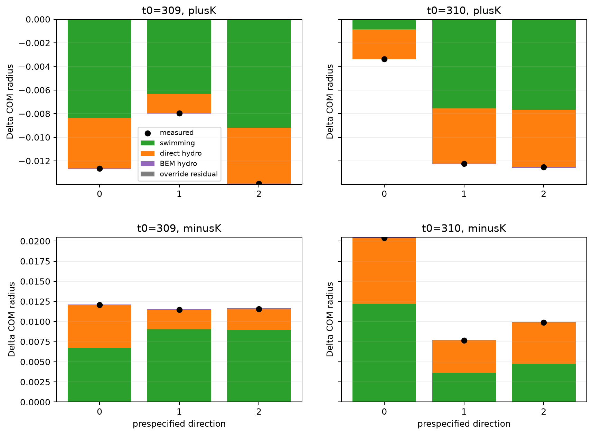
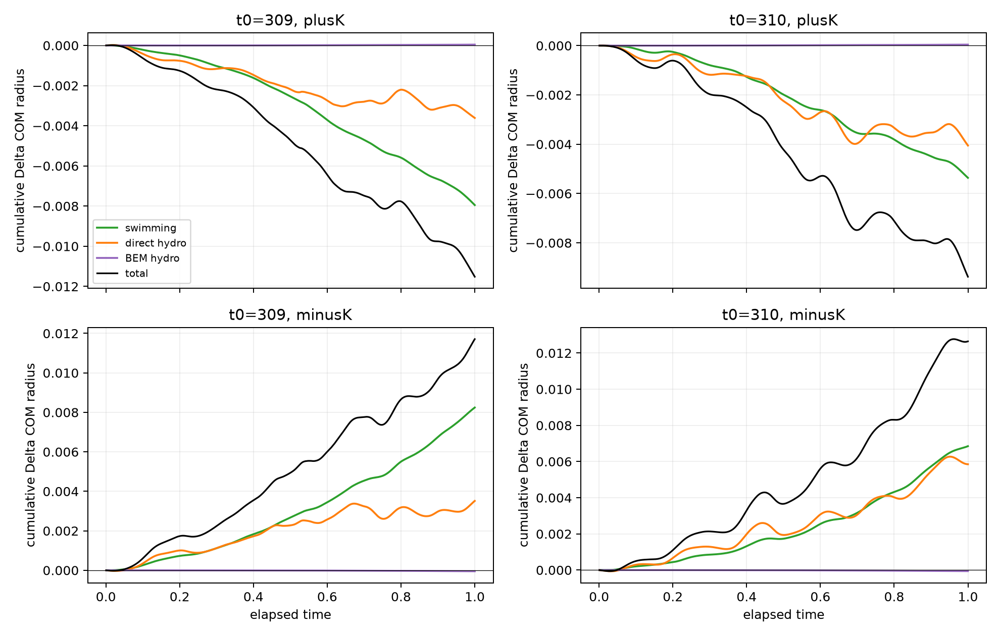
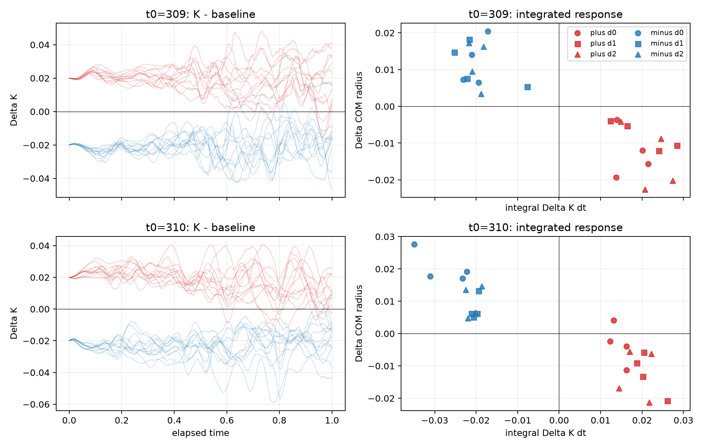

# COM transport and sufficiency of connected circulation

## Verdict

This bounded source-exact experiment establishes three results.

**A. The instantaneous COM response has an identifiable hydrodynamic origin.** The perturbations preserve the full complex polarization `p` exactly, so the initial swimming contribution to the change in COM velocity is zero to numerical precision. Direct fish-fish hydrodynamics supplies nearly all of the initial velocity difference; BEM-mediated translation is 1–2 orders of magnitude smaller.

**B. That initial hydrodynamic kick is not the full mechanism of the one-second radial displacement.** Its radial sign is opposite to the eventual displacement. The cumulative response changes sign within `0.014–0.048` time units. Over one time unit, the changed mean swimming direction supplies about 54–70% of the radial response, direct hydrodynamic transport supplies about 30–46%, and BEM transport remains below 0.5%. Thus the observed COM motion is a dynamically generated combination of reorientation and direct hydrodynamic transport, not persistent advection by the initial hydro kick.

**C. `K` is a causal perturbation axis but not a sufficient collective coordinate.** Three genuinely distinct heading perturbations with the same exact `Delta K`, the same exact complex `p`, and the same heading RMS retain the same mean sign of `K` and COM-radius response. However, their quantitative responses are not identical. At `t=310`, systematic direction-to-direction variation in integrated `K` and COM displacement is comparable to or larger than fresh-noise variation. The microscopic spatial-heading pattern therefore contains predictive information not encoded in `(p,K)`.

This does not show that spontaneous growth of `K` causes the archived schooling-to-milling transition. It shows that `K`-directed heading structure is dynamically consequential, while also rejecting `K` as a closed one-coordinate description of the subsequent motion.

## 1. Exact COM identity and numerical decomposition

The production translation is

```text
rDot_i = e(theta_i) + U_direct,i + U_BEM,i
```

before collision, extreme-velocity, or position-safety overrides. Therefore

```text
dC/dt = mean(e) + mean(U_direct) + mean(U_BEM)
      = (Re p, Im p) + mean(U_direct) + mean(U_BEM).
```

The extracted diagnostic step uses the unchanged arrays already evaluated by the production update. It records four components: swimming, direct hydro, BEM hydro, and the residual produced by any override. The actual mean velocity is recorded independently.

The vector displacement closes by direct summation. For an exact scalar-radius allocation, define for each discrete step

```text
g_n = (C_n + C_{n+1}) / (|C_n| + |C_{n+1}|).
```

Then

```text
|C_{n+1}| - |C_n| = g_n dot (C_{n+1} - C_n)
```

exactly, not only to first order. Projecting every translational component onto `g_n` therefore gives an exact additive radial budget. Across all 64 branch integrations, the maximum vector reconstruction residual is `2.45e-15` and the maximum radial residual is `1.12e-15`.

The unchanged production source is `BEM_circular_parallel_instance.py`, SHA256 `2a415d26ad83cf42a2f3cb0f4ba156b8dd6c11b32972ce8305499eebced22da4`. The diagnostic extracted-step SHA256 is `e804e6198d84f17b4f2707c53dc8625cfa599f1c886f893279be6a78970656eb`.
At both initial states, its updated state, velocity, angular rate, numerical memory, and safeguard flags agree exactly (maximum difference zero) with the previously validated production-step extraction; only extra return values were added.

## 2. Existing pilot states: initial COM velocity

The original minimum-norm `+K` and `-K` perturbations and their equal-RMS controls were replayed for one source-exact instantaneous step. Values below are radial velocity differences from the unperturbed state.

| Start | branch | swimming | direct hydro | BEM hydro | actual total |
|---:|---|---:|---:|---:|---:|
| 309 | +K | `-4.0e-17` | `+1.594e-3` | `-2.34e-5` | `+1.571e-3` |
| 309 | -K | `+3.5e-16` | `-1.451e-3` | `+2.36e-5` | `-1.427e-3` |
| 309 | control + | `-4.9e-16` | `+0.226e-3` | `-0.0003e-3` | `+0.226e-3` |
| 309 | control - | `+1.2e-16` | `+0.725e-3` | `-0.0026e-3` | `+0.723e-3` |
| 310 | +K | `+1.5e-14` | `+1.263e-3` | `-0.0086e-3` | `+1.254e-3` |
| 310 | -K | `-3.3e-16` | `-1.269e-3` | `+0.0088e-3` | `-1.260e-3` |
| 310 | control + | `-1.1e-15` | `+0.0976e-3` | `-0.0005e-3` | `+0.0972e-3` |
| 310 | control - | `+1.3e-17` | `+0.498e-3` | `-0.0001e-3` | `+0.498e-3` |

This verifies the stated identity: because `p` is fixed, the initial response is hydrodynamic. Direct hydro dominates and the targeted perturbations differ substantially from their controls. But the `+K` kick is initially radially outward while its one-second displacement is inward; `-K` shows the reverse. The initial kick therefore cannot by itself explain the final displacement direction.

## 3. Prespecified same-K ensemble

For each archived start and each sign, three perturbations were generated from fixed Gaussian directions with seeds chosen before any outcomes were evaluated. A constrained solve imposed

```text
p(theta + delta) = p(theta),
K(theta + delta) = K(theta) +/- 0.02,
RMS(delta) = fixed value.
```

The common RMS is `0.0397423` radians at `t=309` and `0.0387324` at `t=310`, set to 1.5 times the larger minimum feasible RMS for the two signs at that state. Maximum complex-`p` error is `8.9e-16`; maximum `K` error is `8.6e-16`; maximum norm-constraint residual is `9.7e-14`.

The directions are not near duplicates. Pairwise RMS separations are `0.0385–0.0463` radians and cosine similarities are `0.32–0.51`. No direction was selected, rejected, or tuned using its simulated outcome.

Each state used four new independent Gaussian noise realizations. Within a state/noise block, baseline, duplicate baseline, and all six perturbations received identical per-fish noise at every native step. The eight duplicate baselines agreed exactly for all 1,000 steps.

Even instantaneously, equal `(p,K,RMS)` does not fix hydro transport. For example, direct-hydro radial velocity across the three `t=309,+K` directions ranges from `0.584e-3` to `1.834e-3`; for `t=309,-K` it ranges from `-1.166e-3` to `-2.566e-3`. This variation arises from the unresolved distribution of headings over fish positions.

## 4. One-second transport budget

The table reports grand means over the three prespecified directions; uncertainty and every direction/noise result are retained in the CSV files.

| Start | sign | measured radial displacement | swimming | direct hydro | BEM hydro |
|---:|---|---:|---:|---:|---:|
| 309 | +K | `-0.01152` | `-0.00795` (69%) | `-0.00361` (31%) | `+0.000041` |
| 309 | -K | `+0.01171` | `+0.00824` (70%) | `+0.00351` (30%) | `-0.000048` |
| 310 | +K | `-0.00937` | `-0.00536` (57%) | `-0.00405` (43%) | `+0.000041` |
| 310 | -K | `+0.01265` | `+0.00685` (54%) | `+0.00585` (46%) | `-0.000056` |

Percentages use the signed measured response and are rounded; BEM supplies the small difference from 100%. The translational override residual is at roundoff.



The initially opposite hydro kick is short lived. The ensemble-mean cumulative radial displacement first acquires its final sign at:

| Start | sign | first final-sign time | last opposite-sign time |
|---:|---|---:|---:|
| 309 | +K | 0.029 | 0.028 |
| 309 | -K | 0.038 | 0.037 |
| 310 | +K | 0.014 | 0.013 |
| 310 | -K | 0.048 | 0.047 |

By `tau=0.1`, both altered swimming and direct hydro already contribute with the final sign. Thereafter, changed swimming grows into the larger integrated component. The causal sequence supported by these equations and trajectories is therefore:

1. A position-dependent heading perturbation changes direct hydrodynamic COM velocity immediately while leaving `p` unchanged.
2. The full angular and translational dynamics rapidly reorganize; the initial radial kick reverses.
3. A changed mean swimming direction and changed direct-hydro transport then jointly produce the persistent radial displacement.

This sequence is exact as a transport budget. It does not identify which angular torque source creates the rapid reversal; that was not expanded into another diagnostic.



## 5. Is K sufficient?

All direction-mean responses have the expected sign: `+K` gives positive integrated `Delta K` and negative COM-radius displacement, while `-K` gives the opposite. Thus `K` retains coarse directional information. The trajectories are not quantitatively interchangeable, however.

| Start | sign | integrated-K direction range | mean noise SD | radial direction range | mean noise SD |
|---:|---|---:|---:|---:|---:|
| 309 | +K | 0.00453 | 0.00557 | 0.00596 | 0.00652 |
| 309 | -K | 0.00105 | 0.00400 | 0.00063 | 0.00634 |
| 310 | +K | 0.00688 | 0.00304 | 0.00914 | 0.00689 |
| 310 | -K | 0.00763 | 0.00290 | 0.01274 | 0.00451 |

At `t=309`, hidden-direction variation is mostly smaller than noise variation. At `t=310`, it is comparable to or larger than noise, especially for `-K`. The `t=310,-K` radial direction range is 2.8 times the mean within-direction noise SD. Final polarization responses also differ among directions and have no reproducible sign.



Therefore `(p,K)` does not close the microscopic dynamics, even over one time unit. At minimum, a predictive reduction would need information about how heading deviations are arranged over space. The present test does not choose a new fitted coordinate, but the exact direct-hydro formula indicates the missing information is a position-heading correlation relevant to pairwise dipolar transport, not merely another scalar amplitude of `K`.

## 6. Safeguards, limits, and stopping conclusion

The production wall law, clipping, collision logic, and position-safety retry are unchanged. There were no wall clips, collisions, or position-safety candidates. Four angular-clip fish-steps occurred among nonduplicate branches, all in one `t=309` noise block; they were retained under the production rule. They cannot explain the systematic results across both starts and all noise blocks, but they are recorded rather than hidden.

The run comprises two initial states, three directions per sign, four independent-noise blocks, 1,000 native steps, and 64 full branch integrations including duplicates. Wall time was 671 seconds on four workers. Compact NPZ files contain collective metrics and COM transport components only; no raw microscopic trajectories or MAT files are copied.

The bounded conclusion is:

- **Established:** `K`-directed microscopic heading changes immediately alter direct hydrodynamic translation and subsequently cause coupled changes in swimming direction and direct-hydro transport.
- **Established:** `K` predicts the mean sign of the short-time response at these states.
- **Rejected:** `K` alone is sufficient to predict the magnitude or detailed evolution of COM transport.
- **Unproven:** spontaneous `K` growth is the initiating cause of the natural schooling-to-milling transition, or that the observed COM radial response determines transition probability.

The requested test stops here; no potential, fitted coefficient, surrogate, or parameter sweep is introduced.

## Reproduction

From the repository root:

```bash
OPENBLAS_NUM_THREADS=1 VECLIB_MAXIMUM_THREADS=1 \
MPLCONFIGDIR=/tmp/mplconfig UV_CACHE_DIR=/tmp/uv-cache \
uv run --offline --with numpy --with scipy --with matplotlib python \
  theory/circle_collective_first_stage/connected_circulation/stochastic_branching_transport/run_transport_branching.py \
  --data-dir /Volumes/data/BEM_bichamber/archive_one_R_60/BEM_data \
  --stage all --workers 4
```

`instantaneous_velocity.csv` contains the original-pilot and same-K initial velocity decomposition. `transport_decomposition.csv` closes every branch displacement. `paired_responses.csv`, `direction_summary.csv`, and `sufficiency_summary.csv` contain the direction/noise comparison. `reconstruction_audit.json` records closure and safeguard checks. Original simulations and earlier reports are unchanged.
