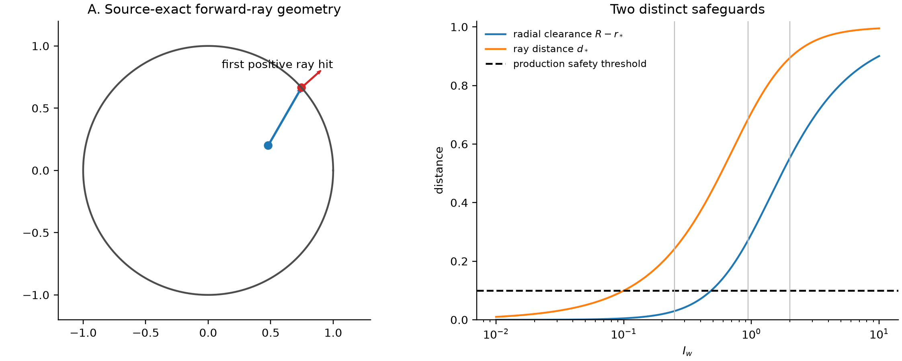
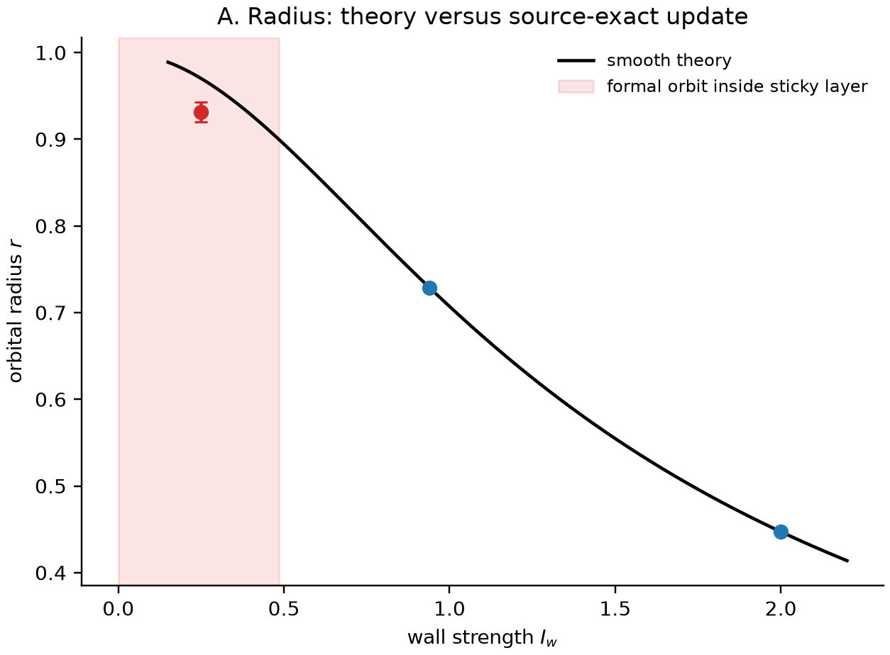
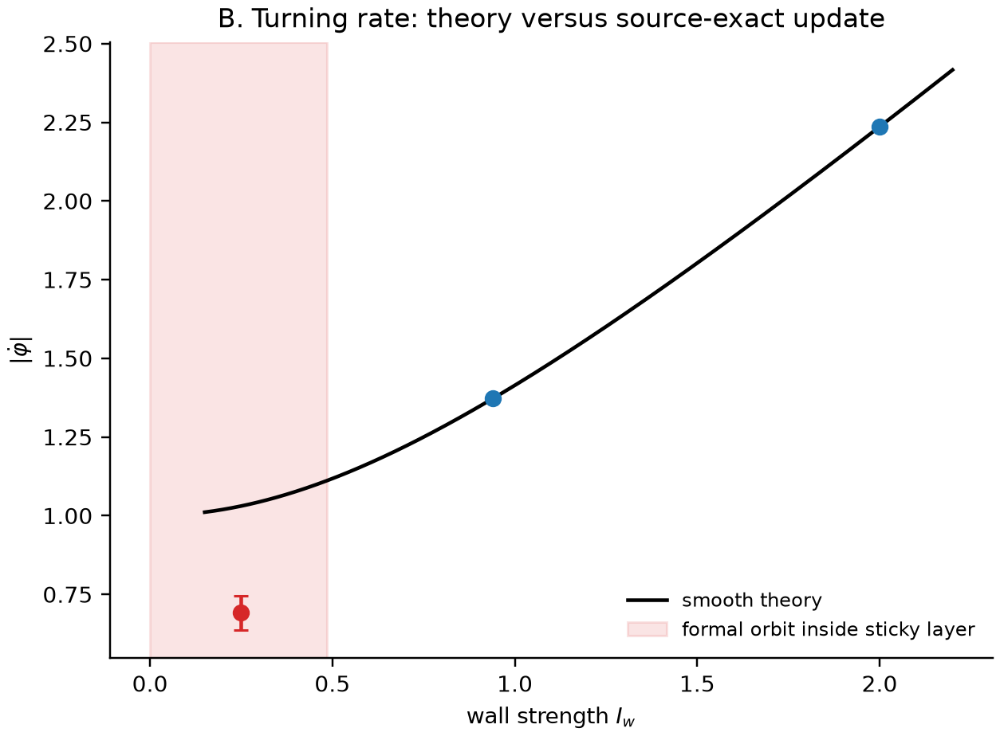
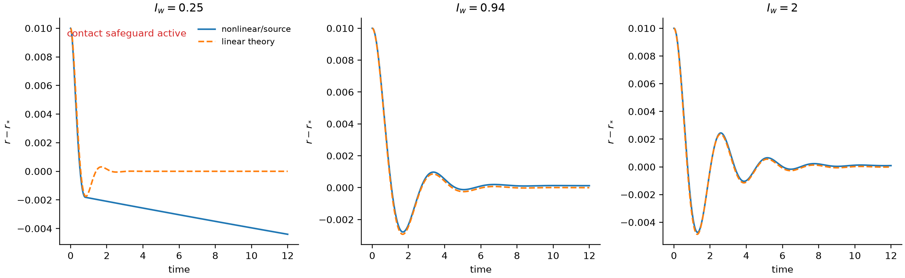
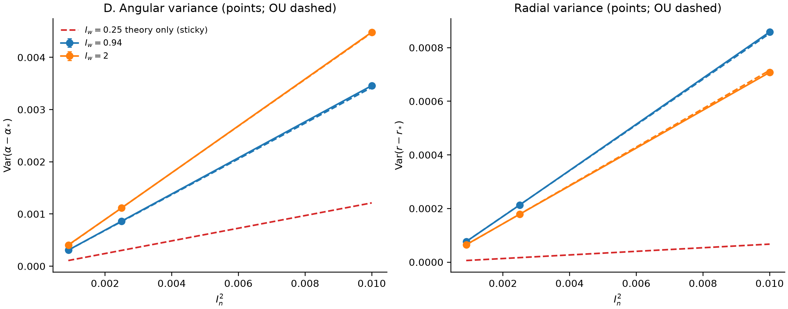
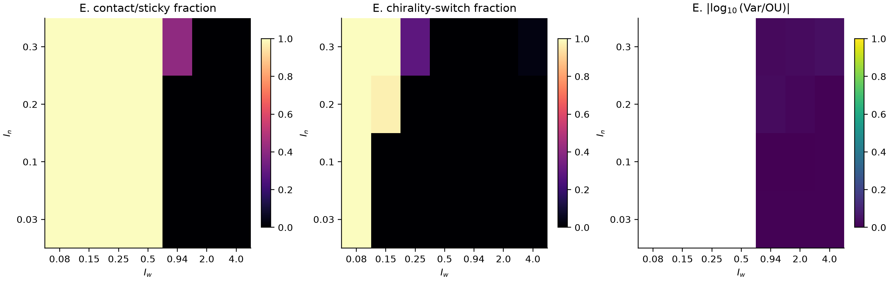

# Source-exact validation of the circular forward-ray wall theory

## Conclusion

The proposed circular orbit and its local Ornstein--Uhlenbeck fluctuations are
quantitatively correct **for the smooth branch of the original wall law**. For
`R=1`, the production simulator adds a separate positional sticky safeguard,
which invalidates the nominal `Iw=0.25` smooth orbit. The clean validations are
therefore `Iw=0.94` and `Iw=2.0`; `Iw=0.25` is a useful negative control showing
where the analytical reduction ceases to represent the production update.

This result establishes a one-fish wall-induced circulating mechanism. It does
not establish a collective schooling-to-milling transition.

## 1. Source audit

The audited production file is
`archive_one_R_60/BEM_circular_parallel_instance.py` (SHA-256
`2a415d26ad83cf42a2f3cb0f4ba156b8dd6c11b32972ce8305499eebced22da4`).
The detailed mapping is in [SOURCE_AUDIT.md](SOURCE_AUDIT.md).

The theory and source agree on the first positive forward-ray intersection,
the circle center, wrapped incidence `theta-theta_hit`, and torque sign. The
noise update is exactly `In*sqrt(dt)*N(0,1)`, so `D_theta=In^2/2`.

There are two distinct production safeguards:

1. If the forward-ray distance `d<=0.1`, the wall torque is multiplied by
   `1+1/d^5`, then clipped at `pi/0.001`. The complete angular rate is clipped
   again at `pi/dt`.
2. If the proposed position lies within radial clearance 0.1 and moves
   outward, translation is frozen but angular drift and noise remain active.

The second rule was missing from the applicability test in the analytical
note. A smooth theoretical orbit requires both `d_star>0.1` and
`R-r_star>0.1`. At `R=1`, the latter gives

```text
Iw > sqrt(1/0.9^2 - 1) = 0.4843221048.
```

Consequently, `Iw=0.25` has formal `r_star=0.97014`, radial clearance
`0.02986`, and lies inside the sticky layer, although its ray distance
`d_star=0.24254` is outside the high-order torque layer.



## 2. Deterministic orbit test

The source-exact Euler update was run for 80 time units from eight initial
conditions per wall strength: four for each chirality, including local and
broad radial/angular perturbations. We used `dt=0.002, 0.001, 0.0005`; reported
production-resolution measurements use `dt=0.001` and the final 20 time units.
There are no social or hydrodynamic terms.

| `Iw` | theory `r_star` | theory `|omega_star|` | source result |
|---:|---:|---:|:---|
| 0.25 | 0.970143 | 1.030776 | rejected as smooth orbit: mean radius bias -0.0388, mean freeze fraction 0.305, 2/8 broad trials reversed chirality |
| 0.94 | 0.728628 | 1.372443 | all 8 retained chirality; maximum radius error 2.50e-4 and frequency error 4.70e-4 |
| 2.00 | 0.447214 | 2.236068 | all 8 retained chirality; maximum radius error 2.00e-4 and frequency error 1.00e-3 |

For `Iw=0.94` and `2`, halving `dt` halves both radius and frequency errors,
consistent with first-order Euler discretization. No safety or clipping event
occurred. These tests establish local/broad convergence for the tested initial
conditions only; they are not a proof of global attraction.





The reason a stable rotation appears is geometrically direct. A tangential
heading makes radial velocity zero. At the predicted radius, the wall-induced
turn rate exactly equals the kinematic azimuthal turn rate. A radial or angular
perturbation changes both the forward-ray distance and the azimuthal rate; the
resulting coupled feedback restores the orbit as a spiral. Increasing `Iw`
moves the balance inward and increases the turning rate.

## 3. Local stability

Radial and angular perturbations of magnitude 0.01 were applied independently
on both chiral branches. Source-exact trajectories used `dt=0.0005` for 12
time units. Rates were measured only over the first two theoretical decay
times, before the `O(dt)` displacement of the discrete Euler orbit dominates
the shrinking perturbation. No coefficient was fitted back into the model.

| `Iw` | decay theory | decay measured | frequency theory | frequency measured | early normalized response RMSE |
|---:|---:|---:|---:|---:|---:|
| 0.25 | 2.0616 | 0.7029 | 3.7165 | 2.0592 | 0.465 |
| 0.94 | 0.7300 | 0.7541 | 1.8661 | 1.8636 | 0.068 |
| 2.00 | 0.5590 | 0.5460 | 2.4367 | 2.4335 | 0.109 |

The valid smooth cases reproduce both eigenvalue components. The `Iw=0.25`
failure coincides with about 1,016 frozen-translation steps per perturbation
trial and is an effect of the actual contact rule, not a failure of the
Jacobian algebra for the smooth differential equation.



## 4. Weak angular noise

For every `(Iw,In)` with `In=0.03,0.05,0.10`, we ran 48 independent trajectories
per chirality (96 per cell), with 100 time units of burn-in and 300 time units
of sampling at `dt=0.001`. Local statistics were kept branch-specific. A
trajectory ceased contributing to the local comparison after a chirality
change, contact/sticky encounter, or torque clipping. Uncertainty is the
standard error across independent trajectory-level variance estimates.

For `Iw=0.94` and `2.0`, all 576 branch trajectories remained clean and no
switch, contact, or clipping event occurred. Across those 12 branch-specific
comparisons:

- median measured/theory angular-variance ratio: **1.0072**;
- angular-ratio range: **0.9898--1.0163**;
- median measured/theory radial-variance ratio: **1.0011**;
- radial-ratio range: **0.9784--1.0153**;
- maximum independent-trajectory standard error was about **1.1%** of the
  corresponding variance;
- maximum absolute correlation inferred from `Cov(r,alpha)` was **8.8e-4**.

The three points are linear in `In^2` to this accuracy, with the predicted
parameter-dependent slope. At `Iw=0.94, In=0.05`, changing `dt` from 0.002 to
0.0005 changed the angular ratio from 1.0170 to 1.0076 and the radial ratio
from 1.0034 to 0.9981.

No `Iw=0.25` trajectory qualifies for the smooth local covariance test because
all encounter the positional safeguard. It would be misleading to report the
conditional survivors or mix the resulting regulated dynamics with the OU
prediction.



## 5. Where the theory fails

A bounded diagnostic grid used 32 trajectories per cell, 50 time units burn-in
and 100 time units sampling, for seven `Iw` values and four `In` values. It is
a validity map, not a fitted phase diagram.



The observed failure modes separate cleanly:

- **Analytical approximation:** at larger noise, the local linear covariance
  receives nonlinear corrections. For valid, contact-free `Iw=2`, the angular
  ratio rises from 0.989 at `In=0.03` to 1.067 at `In=0.30`.
- **Actual near-contact interaction:** every tested trajectory at
  `Iw<=0.50` encountered the positional safeguard over the diagnostic horizon.
  The `Iw=0.50` formal clearance is only 0.0056 outside the threshold, so even
  weak fluctuations eventually touch it. At `Iw=0.94, In=0.30`, 40.6% touched
  the layer and only 70.2% of the planned clean sample exposure remained.
- **Clipping:** at `Iw=0.08`, the high-order wall rule produced clipping and
  chirality changes in every trajectory. At `Iw=0.15`, clipping/switching
  appeared at `In>=0.20`. This is regulated production dynamics, not the
  smooth equation.
- **Numerical discretization:** in the smooth cases it is first order and small
  at `dt=0.001`; the deterministic and stochastic refinement tests quantify it.
- **State switching:** no switch occurred in the primary weak-noise smooth
  validation. In the extension, `Iw=4, In=0.30` switched in 3.1% of trajectories.
  Those intervals were excluded from local branch covariance rather than
  being counted as large fluctuations.

The sharp deterministic criterion `Iw>0.4843` is necessary but not sufficient
for a long noisy trajectory to avoid the contact layer; the practical boundary
also depends on noise amplitude and observation time.

## Direct answers

1. **Is the predicted wall-induced circular orbit correct?** Yes, for the
   unregularized forward-ray branch and for production trajectories that stay
   outside both safeguards. `Iw=0.94` and `2` agree at the expected Euler error.
   The production `Iw=0.25` case is not governed by that smooth orbit.
2. **Is local stability correctly predicted?** Yes in the two smooth cases:
   both decay and oscillation agree, and the full early perturbation waveform
   is reproduced. The theory is local, not a global-basin theorem.
3. **Do weak-noise variances agree quantitatively?** Yes. In clean branch-
   conditioned data the radial and angular variances agree within roughly 2.2%
   in every primary comparison and covariance is negligible. The predicted
   `In^2` scaling is observed.
4. **Where and why does it break down?** Small `Iw` brings the orbit into the
   positional sticky layer; still smaller `Iw` can activate high-order torque
   and clipping. Larger noise causes contact, nonlinearity and eventually
   chirality switching. Euler errors are separately small and convergent.
5. **What is the next tractable collective step?** Restore the source's exact
   visible-Delaunay social alignment and attraction with hydrodynamics and
   noise still off. Compute a deterministic rotating relative equilibrium for
   a small school, then linearize the full piecewise-smooth microscopic update
   while holding each realized Delaunay topology fixed. Report eigenmodes and
   the distance to graph-switch surfaces. Only after this source-exact social
   stability test should direct and BEM hydrodynamics be added separately.
   This tests whether wall-induced rotation survives social coupling without
   inventing a collective torque or effective potential.

## Reproducibility

The main script is [run_validation.py](run_validation.py). Committed data are
in `tables/`, and compact headline metrics are in `summary.csv` and
`summary.json`. The deterministic RNG streams are zero; stochastic seeds are
fixed functions of `(Iw,In,dt)` in the script, beginning with 710000 for the
primary ensemble and 990000 for the validity map. The exact command is in
[README.md](README.md).
